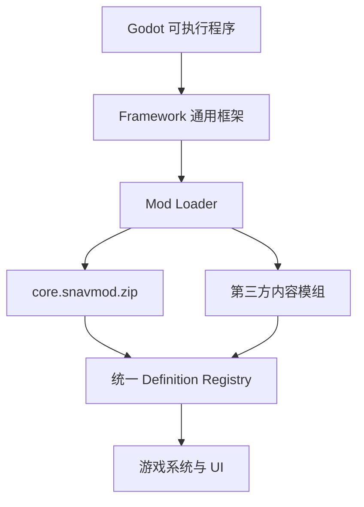
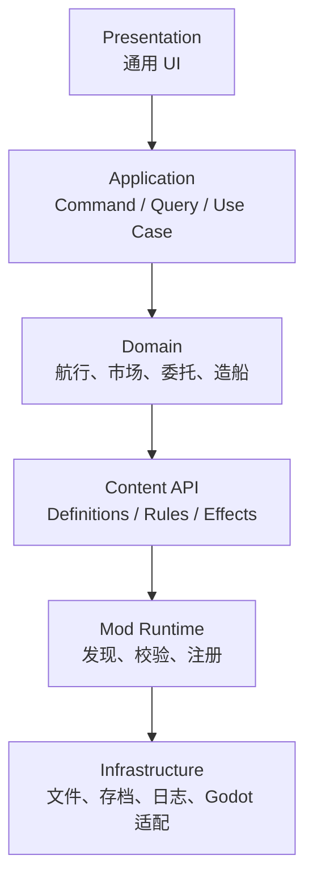
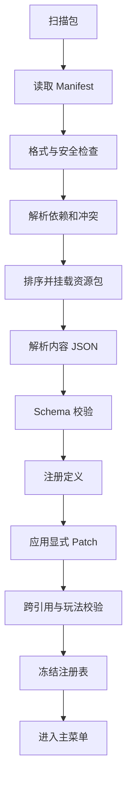

# 《蒸汽航海》项目架构方案：框架 + 模组

> 文档版本：v1.0  
> 对应设计：MVP GDD v1.0  
> 目标引擎：Godot 4.x  
> 目标平台：PC 桌面端  
> 核心模式：Framework + Core Mod + Optional Mods

---

## 1. 架构目标

### 1.1 总体原则

游戏本体只包含通用框架，不直接内置任何具体港口、商品、船体、锅炉、委托或事件内容。官方 MVP 内容由 `core` 模组提供，并通过与第三方内容模组相同的发现、校验、挂载、注册和存档兼容流程加载。



### 1.2 框架负责什么

- 模组发现、版本检查、依赖排序、装载和错误隔离。
- 数据结构、Schema 校验、跨引用校验和注册表冻结。
- 新局生成、随机数、时钟、市场、航行、风险、委托、制造、贷款、声誉与存档算法。
- 通用 UI、命令系统、查询系统、事件总线和资源解析。
- 为模组提供稳定、受控、可版本化的接口。

### 1.3 Core 模组负责什么

- 官方港口与港口原型。
- 普通商品、专用造船材料。
- 船体、锅炉、货舱、导航、安全与客舱定义。
- 经济、标准、极速三种航行策略的数据参数。
- 工程师、领航员岗位定义。
- 五段主线委托、普通委托模板。
- 故障事件与商船事件内容。
- 初始两套构筑。
- 本地化文本、图标、占位图、音效引用。
- MVP 数值预设和地图生成配置。

### 1.4 非目标

- 不允许内容模组直接修改框架 Node 树。
- 不允许内容模组直接读写全局 `GameState` Dictionary。
- 不允许模组依赖加载顺序偷覆盖同路径资源。
- MVP 不开放任意第三方 GDScript 执行。
- 不将存档对象、Godot Node 或 Resource 实例直接作为跨模组 API。

---

## 2. 分层架构



### 2.1 Presentation

- 海图主界面与通用侧边面板。
- 按定义类型渲染交易、委托、造船、情报和补给数据。
- 只通过 Query 获取只读 ViewModel，通过 Command 发起修改。
- UI 不识别 `core`，只识别接口与定义类型。

### 2.2 Application

- 编排一次完整用例，例如“接受委托”“购买商品”“开始航行”。
- 校验命令前置条件。
- 建立事务边界，成功后统一提交状态并发出领域事件。
- 为 UI、自动测试和未来脚本接口提供同一入口。

### 2.3 Domain

- 纯规则与状态转换，不读文件、不创建界面、不直接访问 Godot 场景树。
- 关键模拟尽量写成输入确定、输出确定的纯函数。
- 所有随机结果必须从 `RngService` 的命名随机流取得。

### 2.4 Content API

- 将模组 JSON 转换为只读定义对象。
- 解析 ID、标签、条件和效果。
- 提供统一注册表和查询接口。

### 2.5 Mod Runtime

- 扫描模组包。
- 读取清单。
- 解析 SemVer 依赖。
- 按拓扑顺序挂载。
- 读取和校验内容。
- 生成最终内容集合与加载报告。

### 2.6 Infrastructure

- Godot `FileAccess`、`ZIPReader`、`ProjectSettings.load_resource_pack()` 适配。
- JSON 解析、日志、哈希、自动存档与原子写入。
- 资源路径、图片、音频和本地化加载。

---

## 3. 推荐项目目录

```text
steam_navigator/
├── project.godot
├── framework/
│   ├── bootstrap/
│   │   ├── bootstrap.gd
│   │   ├── app_context.gd
│   │   └── startup_report.gd
│   ├── modding/
│   │   ├── mod_loader.gd
│   │   ├── mod_manifest.gd
│   │   ├── dependency_resolver.gd
│   │   ├── schema_validator.gd
│   │   ├── content_compiler.gd
│   │   └── registries/
│   ├── application/
│   │   ├── command_bus.gd
│   │   ├── query_bus.gd
│   │   └── commands/
│   ├── domain/
│   │   ├── voyage/
│   │   ├── economy/
│   │   ├── contracts/
│   │   ├── ship/
│   │   ├── reputation/
│   │   └── debt/
│   ├── services/
│   │   ├── rng_service.gd
│   │   ├── clock_service.gd
│   │   ├── asset_service.gd
│   │   ├── localization_service.gd
│   │   └── save_service.gd
│   ├── state/
│   │   ├── game_state.gd
│   │   └── state_migrations/
│   ├── ui/
│   │   ├── map/
│   │   ├── panels/
│   │   ├── voyage/
│   │   └── common/
│   └── tests/
├── schemas/
│   ├── manifest.schema.json
│   ├── good.schema.json
│   ├── module.schema.json
│   ├── contract.schema.json
│   ├── event.schema.json
│   └── map_profile.schema.json
├── sdk/
│   ├── templates/
│   ├── examples/
│   ├── validators/
│   └── pack_mod.gd
├── dev_mods/
│   └── core/
└── dist/
    ├── SteamNavigator.exe
    └── mods/
        └── core.snavmod.zip
```

发布版本中，`framework/` 被编译进主程序；官方内容从 `mods/core.snavmod.zip` 加载。

---

## 4. 模组包格式

### 4.1 文件扩展名

正式分发格式：

```text
<mod_id>-<version>.snavmod.zip
```

示例：

```text
core-1.0.0.snavmod.zip
better-boilers-1.2.0.snavmod.zip
```

该文件本质是 Godot 可加载的 ZIP resource pack。保留 `.zip` 后缀，避免依赖引擎对自定义扩展名的识别行为。

开发环境还允许同结构的松散目录：

```text
user://mods_dev/<mod_id>/
```

松散目录只用于 Debug 构建，Release 构建默认禁用。

### 4.2 包内目录规范

所有文件必须位于自己的命名空间目录中：

```text
mods/<mod_id>/
├── manifest.json
├── content/
│   ├── goods.json
│   ├── materials.json
│   ├── hulls.json
│   ├── boilers.json
│   ├── cargo_modules.json
│   ├── navigation_modules.json
│   ├── safety_modules.json
│   ├── cabins.json
│   ├── roles.json
│   ├── strategies.json
│   ├── contracts.json
│   ├── events.json
│   ├── port_archetypes.json
│   ├── map_profiles.json
│   └── starting_builds.json
├── localization/
│   ├── zh_CN.json
│   └── en.json
├── assets/
│   ├── icons/
│   ├── textures/
│   ├── audio/
│   └── themes/
└── tests/
    └── expected_validation.json
```

禁止模组把文件放到 `res://framework/`、`res://schemas/` 或其他模组目录。

### 4.3 必需文件

每个包必须包含：

- `mods/<mod_id>/manifest.json`
- 至少一个 `content/*.json`
- 清单中声明的所有资源文件

`core` 模组还必须包含：

- 至少一个可用初始构筑。
- 至少一个地图生成配置。
- 五段主线委托。
- 满足最低可航行配置的船体、锅炉和货舱。

### 4.4 Manifest 规范

```json
{
  "$schema": "https://steam-navigator.local/schema/mod-manifest-1.json",
  "id": "core",
  "name": "Steam Navigator Core Content",
  "version": "1.0.0",
  "api_version": "1.0",
  "type": "content",
  "load_priority": 0,
  "required": true,
  "dependencies": [],
  "optional_dependencies": [],
  "conflicts": [],
  "content": [
    "content/goods.json",
    "content/hulls.json",
    "content/boilers.json",
    "content/contracts.json",
    "content/events.json"
  ],
  "localization": [
    "localization/zh_CN.json",
    "localization/en.json"
  ],
  "assets": {
    "icon.coal": "assets/icons/coal.svg"
  },
  "authors": ["Steam Navigator Team"],
  "license": "Proprietary",
  "description": "Official MVP content.",
  "checksum": "sha256:<generated-at-pack-time>"
}
```

### 4.5 Manifest 字段约束

| 字段 | 规则 |
|---|---|
| `id` | 必需；`^[a-z][a-z0-9_]{2,31}$`；全局唯一 |
| `version` | 必需；SemVer 2.0，例如 `1.2.0` |
| `api_version` | 必需；`major.minor`；声明目标框架接口 |
| `type` | MVP 只允许 `content` |
| `load_priority` | 同一依赖层内排序；不能替代依赖声明 |
| `required` | 仅官方分发包可设为 `true` |
| `dependencies` | 依赖 ID 和版本范围 |
| `conflicts` | 显式不兼容模组列表 |
| `content` | 相对模组根目录的 JSON 清单 |
| `assets` | 逻辑资源键到相对路径的映射 |
| `checksum` | 包内容 SHA-256；开发目录可省略 |

依赖示例：

```json
{
  "id": "core",
  "version": ">=1.0.0 <2.0.0"
}
```

### 4.6 允许与禁止的文件

MVP 内容模组允许：

- `.json`
- `.csv`，仅本地化或批量数值表；打包前应转换为 JSON
- `.png`、`.webp`、`.svg`
- `.ogg`、`.wav`
- Godot 已导入的只读美术资源

MVP 内容模组禁止：

- `.gd`、`.gdshader` 中的可执行逻辑
- `.dll`、`.so`、`.dylib`、`.exe`
- 含脚本引用的 `.tscn`、`.tres`
- 绝对路径和 `..` 路径穿越
- 覆盖 `res://framework/**`
- 从 JSON 指定任意类名、方法名或脚本路径并反射执行

---

## 5. 内容 ID 与引用规则

### 5.1 规范 ID

所有可引用内容使用三段式 ID：

```text
<mod_id>:<type>/<local_id>
```

示例：

```text
core:good/coal
core:hull/small_efficient
core:boiler/medium_performance
core:contract/main_05
better_boilers:boiler/compound_efficient
```

### 5.2 引用要求

- 模组内部也必须使用完整 ID，不允许省略命名空间。
- ID 一经发布不得改变语义。
- 删除已发布 ID 时，至少保留一个大版本周期的迁移别名。
- UI 文本使用本地化键，不直接把显示名称当 ID。
- 存档只保存 ID 和必要运行态，不序列化定义对象。

### 5.3 标签

标签用于宽松组合，不替代稳定 ID：

```text
good.bulk
good.shipbuilding
module.efficient
module.performance
port.shipyard
contract.passenger
risk.mechanical
```

规则可以查询标签集合，但主线关键内容应引用明确 ID，避免其他模组意外改变流程。

---

## 6. 内容文件通用格式

### 6.1 文件外壳

每个内容 JSON 使用统一外壳：

```json
{
  "schema_version": "1.0",
  "content_type": "goods",
  "definitions": [
    {
      "id": "core:good/coal",
      "name_key": "good.core.coal.name",
      "description_key": "good.core.coal.description",
      "tags": ["good.bulk", "good.fuel"],
      "enabled": true,
      "data": {}
    }
  ]
}
```

### 6.2 通用字段

| 字段 | 类型 | 说明 |
|---|---|---|
| `schema_version` | string | 当前内容 Schema 版本 |
| `content_type` | enum | 必须与目标注册表一致 |
| `definitions` | array | 定义数组 |
| `id` | string | 全局规范 ID |
| `name_key` | string | 本地化名称键 |
| `description_key` | string | 本地化描述键 |
| `tags` | string[] | 查询与组合标签 |
| `enabled` | bool | 是否进入最终内容集合 |
| `data` | object | 类型专属字段 |

### 6.3 商品示例

```json
{
  "id": "core:good/brass",
  "name_key": "good.core.brass.name",
  "description_key": "good.core.brass.description",
  "tags": ["good.trade", "good.shipbuilding"],
  "enabled": true,
  "data": {
    "unit_weight": 2.0,
    "base_price": 90,
    "price_elasticity": 0.18,
    "spawn_weight": 1.0,
    "crafting_material": true
  }
}
```

### 6.4 模块示例

```json
{
  "id": "core:boiler/small_efficient",
  "name_key": "module.core.small_efficient_boiler.name",
  "tags": ["module.boiler", "module.small", "module.efficient"],
  "enabled": true,
  "data": {
    "tier": 1,
    "weight": 8.0,
    "purchase_price": 420,
    "craft_time_hours": 4,
    "craft_cost": 0,
    "materials": [
      {"id": "core:good/brass", "amount": 4}
    ],
    "modifiers": [
      {"stat": "coal_rate", "op": "mul", "value": 0.78},
      {"stat": "water_rate", "op": "mul", "value": 0.82},
      {"stat": "speed", "op": "mul", "value": 0.94}
    ]
  }
}
```

### 6.5 委托示例

```json
{
  "id": "core:contract/main_05",
  "name_key": "contract.core.main_05.name",
  "tags": ["contract.main", "contract.cargo", "contract.passenger"],
  "enabled": true,
  "data": {
    "sequence": 5,
    "generator": "route_pair",
    "constraints": {
      "requires_discovered_origin": true,
      "min_route_edges": 1,
      "max_route_edges": 3,
      "required_port_tags": []
    },
    "payloads": [
      {"kind": "cargo", "weight_range": [22, 30]},
      {"kind": "passenger", "count_range": [2, 4]}
    ],
    "deadline_formula": "balanced_finale",
    "rewards": {
      "base_money": [900, 1200],
      "on_time_bonus": [500, 700],
      "reputation": 2,
      "unlock_ids": ["core:hull/large_efficient", "core:hull/large_performance"]
    }
  }
}
```

公式字段不得包含任意表达式源码。`balanced_finale` 必须是框架已注册的安全公式 ID。

---

## 7. 声明式条件与效果协议

### 7.1 设计目的

内容模组不能执行脚本，因此通过有限 DSL 表达条件与结果。DSL 只允许框架登记的操作码。

### 7.2 条件格式

```json
{
  "all": [
    {"op": "reputation_gte", "value": 2},
    {"op": "has_module_tag", "tag": "module.cabin"},
    {"op": "port_has_tag", "tag": "port.shipyard"}
  ]
}
```

允许的组合器：

- `all`
- `any`
- `not`

MVP 首批条件操作码：

- `money_gte`
- `reputation_gte`
- `debt_lte`
- `at_port`
- `port_has_tag`
- `has_item`
- `has_module`
- `has_module_tag`
- `has_role`
- `contract_completed`
- `port_discovered`
- `ship_tier_gte`
- `durability_gte`

### 7.3 效果格式

```json
[
  {"op": "remove_water", "amount": 8},
  {"op": "add_delay_hours", "amount": 2},
  {"op": "damage_ship", "amount": 4},
  {"op": "emit_notice", "text_key": "event.core.overheat.cooled"}
]
```

MVP 首批效果操作码：

- `add_money` / `remove_money`
- `add_reputation` / `remove_reputation`
- `add_item` / `remove_item`
- `add_coal` / `remove_coal`
- `add_water` / `remove_water`
- `damage_ship` / `repair_ship`
- `add_delay_hours`
- `damage_cargo`
- `injure_passenger`
- `unlock_definition`
- `complete_contract`
- `fail_voyage`
- `reveal_port_facilities`
- `update_intelligence`
- `emit_notice`

每个操作码必须有独立参数 Schema、纯函数执行器和单元测试。

### 7.4 执行限制

- 单个事件最多 16 个条件节点、16 个效果节点。
- 条件求值无副作用。
- 效果按数组顺序执行，但在事务中一次性提交。
- 任一效果校验失败时，整个效果事务回滚。
- 模组不能通过字符串调用任意方法。

---

## 8. 框架接口约定

### 8.1 接口总览

| 接口 | 方向 | 用途 |
|---|---|---|
| `IModCatalog` | 框架 → 模组数据 | 读取清单与文件列表 |
| `IDefinitionRegistry` | 模组数据 → 框架 | 注册不可变内容定义 |
| `IAssetResolver` | 系统/UI → 模组资源 | 逻辑资源键解析 |
| `IQueryBus` | UI/测试 → 应用层 | 获取只读 ViewModel |
| `ICommandBus` | UI/测试 → 应用层 | 请求状态变更 |
| `IDomainEventBus` | 领域 → 订阅者 | 发布已提交事件 |
| `IRngService` | 领域 → 基础服务 | 可复现随机数 |
| `IClockService` | 领域 → 基础服务 | 读取和推进游戏时间 |
| `ISaveCodec` | 状态 → 持久化 | 存档与迁移 |
| `ILogger` | 全层 | 结构化日志与模组归因 |

GDScript 不提供传统语言的强接口约束，因此使用抽象基类、具名方法、启动期能力检查与测试契约共同约束。

### 8.2 Definition Registry

```gdscript
class_name DefinitionRegistry
extends RefCounted

func register(definition: ContentDefinition, source_mod: StringName) -> Error:
    pass

func get_by_id(id: StringName) -> ContentDefinition:
    pass

func get_all(type: StringName) -> Array[ContentDefinition]:
    pass

func query(type: StringName, required_tags: PackedStringArray) -> Array[ContentDefinition]:
    pass

func contains(id: StringName) -> bool:
    pass

func freeze() -> void:
    pass
```

约束：

- 注册阶段结束后必须 `freeze()`。
- 运行中定义不可变。
- 运行态数量、库存、耐久等只能进入 `GameState`。
- 重复 ID 默认报错，不能静默覆盖。

### 8.3 Query Bus

```gdscript
var result := QueryBus.execute(&"market.get_port_view", {
    "port_id": "core:port/iron_harbor"
})
```

查询要求：

- 只读、无副作用。
- 返回普通 Dictionary、Array 和基础类型组成的 ViewModel。
- 不返回可修改的内部对象引用。
- 查询失败返回结构化 `Result`，不以 `null` 混淆“无数据”和“错误”。

### 8.4 Command Bus

```gdscript
var result := CommandBus.execute(&"trade.buy", {
    "port_id": "core:port/iron_harbor",
    "good_id": "core:good/brass",
    "amount": 3
})
```

统一结果：

```gdscript
{
    "ok": true,
    "error_code": "",
    "message_key": "",
    "data": {},
    "events": []
}
```

Command 必须：

1. 校验参数类型。
2. 校验当前状态和前置条件。
3. 在事务副本上执行。
4. 验证不变量。
5. 提交状态。
6. 发布领域事件。
7. 请求 UI 刷新与自动存档。

MVP 首批命令：

```text
trade.buy
trade.sell
contract.accept
contract.deliver
ship.install_module
ship.store_module
ship.craft_module
supply.buy_coal
supply.buy_water
supply.repair
crew.assign
crew.unassign
intel.refresh
debt.borrow
voyage.preview
voyage.start
event.choose_option
run.start
run.restart
```

`voyage.preview` 虽然名为命令，推荐实现为无副作用 Application Use Case，返回一次可复现的预览结果；真正状态变化只发生在 `voyage.start`。

### 8.5 Domain Event Bus

事件命名：

```text
run.started
port.discovered
port.arrived
market.changed
contract.accepted
contract.completed
contract.late
ship.module_installed
ship.damaged
voyage.started
voyage.event_triggered
voyage.completed
voyage.failed
debt.overdue
content.unlocked
run.completed
```

事件载荷必须包含：

```json
{
  "event_id": "uuid",
  "event_type": "voyage.completed",
  "game_time": 42.5,
  "source": "framework",
  "payload": {},
  "schema_version": "1.0"
}
```

规则：

- 只发布已经提交的事实。
- 订阅者不能修改原事件载荷。
- UI 订阅领域事件只用于刷新和表现，不承担规则计算。
- 内容模组不能注册任意事件回调，只能在数据中声明受支持的触发器。

### 8.6 RNG 接口

```gdscript
var rng := RngService.stream(&"market", context_key)
var value := rng.randf()
```

命名随机流：

- `map_generation`
- `goods_generation`
- `npc_trade`
- `contract_generation`
- `voyage_risk`
- `voyage_event`
- `event_options`

不同系统不得共享同一随机流。这样增加一个 UI 随机动画不会改变市场或事故结果。

---

## 9. 模组覆盖与扩展规则

### 9.1 默认规则

- 新 ID：允许注册。
- 重复 ID：默认错误。
- 修改其他模组定义：必须使用显式 Patch。
- 删除其他模组定义：MVP 禁止。
- 修改框架资源：禁止。

### 9.2 显式 Patch

```json
{
  "schema_version": "1.0",
  "content_type": "patches",
  "definitions": [
    {
      "target": "core:boiler/small_efficient",
      "requires": {"mod": "core", "version": ">=1.0.0 <1.1.0"},
      "operations": [
        {"op": "replace", "path": "/data/purchase_price", "value": 380},
        {"op": "replace", "path": "/data/modifiers/0/value", "value": 0.75}
      ]
    }
  ]
}
```

MVP Patch 只允许：

- `add`
- `replace`
- `remove`，但仅限非关键可选字段

禁止 Patch：

- 修改定义 `id`。
- 删除必需字段。
- 把数值改为非有限值。
- 改写框架公式或操作码执行器。
- 修改 `core` 主线顺序而不声明专用兼容能力。

### 9.3 Patch 冲突

若两个模组修改相同 JSON Pointer：

- 默认判定冲突并阻止启动该组合。
- 用户可以在模组管理界面选择显式优先级后重试。
- 加载器生成最终值、来源模组和覆盖链报告。
- 不以文件名或扫描顺序作为隐式胜负规则。

---

## 10. 加载生命周期



### 10.1 启动阶段

1. `Bootstrap._init()` 启动，任何游戏场景预加载前发现模组。
2. 扫描程序目录 `mods/`、`user://mods/` 和 Debug 专用 `user://mods_dev/`。
3. 使用 `ZIPReader` 只读取 Manifest，不执行或挂载内容。
4. 校验文件名、包路径、大小、哈希和禁止扩展名。
5. 解析依赖图，检测缺失、版本不匹配、循环依赖和冲突。
6. 按依赖拓扑、显式优先级、模组 ID 稳定排序。
7. 使用 `ProjectSettings.load_resource_pack(pack_path, false)` 挂载 ZIP，禁止覆盖已存在路径。
8. 解析清单声明的 JSON 文件。
9. 完成 Schema、语义和跨引用校验。
10. 应用 Patch，构建最终定义集合。
11. 执行 Core 完整性检查。
12. 冻结注册表，之后才允许实例化主菜单和游戏场景。

### 10.2 Core 模组特殊规则

- `core` 必须存在且 ID 必须精确为 `core`。
- `core.required` 必须为 `true`。
- `core` 加载失败时不进入游戏，只显示启动报告与日志位置。
- 第三方模组可以依赖 `core`，框架本身不能依赖任何 `core:*` 具体内容 ID。
- 开发测试必须能以“空框架模式”启动到诊断场景，证明框架没有硬编码 Core 内容。

### 10.3 失败分级

| 级别 | 示例 | 处理 |
|---|---|---|
| Fatal | Core 缺失、Schema 主版本不兼容 | 阻止进入游戏 |
| Mod Disabled | 第三方依赖缺失、路径非法 | 禁用该模组及依赖它的模组 |
| Definition Rejected | 单条普通商品定义字段非法 | 拒绝该定义；若被引用则升级为禁用模组 |
| Warning | 缺少非当前语言翻译、可选图标缺失 | 使用回退值并继续 |

---

## 11. 内容注册表

MVP 建议设置独立注册表：

```text
GoodRegistry
MaterialRegistry
HullRegistry
BoilerRegistry
CargoModuleRegistry
NavigationModuleRegistry
SafetyModuleRegistry
CabinRegistry
RoleRegistry
StrategyRegistry
ContractRegistry
EventRegistry
PortArchetypeRegistry
MapProfileRegistry
StartingBuildRegistry
FormulaRegistry      # 仅框架可写
ConditionOpRegistry  # 仅框架可写
EffectOpRegistry     # 仅框架可写
```

所有注册表提供相同基础查询约定：

```text
contains(id)
get(id)
all()
with_tags(tags)
source_of(id)
```

系统不得遍历模组文件目录临时查数据；运行时只访问已冻结注册表。

---

## 12. 资产接口

### 12.1 逻辑资源键

内容定义不直接依赖物理路径：

```json
{
  "icon": "asset://core/icon.coal"
}
```

Manifest 映射：

```json
{
  "assets": {
    "icon.coal": "assets/icons/coal.svg"
  }
}
```

`AssetService` 将其解析为：

```text
res://mods/core/assets/icons/coal.svg
```

### 12.2 资源回退

1. 请求的模组资源。
2. Core 同类型默认资源。
3. Framework 内置缺失资源占位符。

资源缺失不能导致存档损坏或游戏崩溃。

---

## 13. 存档约定

### 13.1 存档头

```json
{
  "save_schema": "1.0",
  "framework_version": "0.1.0",
  "mod_api_version": "1.0",
  "created_at": "2026-10-18T10:00:00Z",
  "seed": 123456789,
  "mods": [
    {
      "id": "core",
      "version": "1.0.0",
      "checksum": "sha256:..."
    }
  ],
  "state": {}
}
```

### 13.2 兼容规则

- 打开存档前比较启用模组的 ID、版本和哈希。
- 缺失提供存档中实际实例 ID 的模组时，默认拒绝加载。
- 只有未被该存档引用的可选模组缺失时才允许继续。
- 模组版本变化时先运行声明式 ID 别名和数据迁移。
- 自动存档先写临时文件，校验成功后原子替换正式文件。
- 出航前重试快照与入港长期自动存档分开保存。

### 13.3 模组迁移文件

```json
{
  "from": ">=1.0.0 <1.2.0",
  "to": "1.2.0",
  "aliases": {
    "old_mod:boiler/eco_a": "old_mod:boiler/eco_mk1"
  },
  "defaults": {}
}
```

MVP 不允许模组用脚本迁移存档，只支持框架定义的声明式迁移操作。

---

## 14. 安全边界

### 14.1 内容模组

默认内容模组是数据，不是代码：

- 不能执行任意 GDScript。
- 不能访问网络、操作系统或任意文件。
- 不能调用框架对象方法。
- 只能使用白名单条件、效果和公式 ID。

### 14.2 资源包风险

资源包仍视为不可信输入。加载前必须：

- 限制单包压缩前后大小。
- 限制文件数量和嵌套深度。
- 拒绝路径穿越和绝对路径。
- 拒绝禁止扩展名。
- 要求所有内部路径位于 `mods/<manifest.id>/`。
- 生产版 Core 可验证发行签名或固定哈希。

### 14.3 未来可信代码模组

若正式版需要新算法或全新 UI，可增加 `type: trusted_plugin`：

- 默认关闭，启用时显示“可执行任意本机代码”的明确警告。
- 使用单独的 `ModPlugin` 抽象基类和能力声明。
- 不承诺安全沙箱；Godot 主进程内 GDScript 应视为完全受信代码。
- 可信插件 API 与当前内容 API 分开版本化。
- 不在 MVP 实现。

建议接口预留：

```gdscript
class_name ModPlugin
extends RefCounted

func get_plugin_api_version() -> String:
    return "1.0"

func register_capabilities(context: PluginContext) -> void:
    pass

func shutdown() -> void:
    pass
```

`PluginContext` 只暴露能力对象，不暴露 SceneTree 根节点或 Autoload 实例。

---

## 15. 版本策略

### 15.1 三种版本

| 版本 | 示例 | 作用 |
|---|---|---|
| Framework | `0.1.0` | 可执行程序与算法版本 |
| Mod API | `1.0` | Manifest、Schema、命令、事件和 DSL 契约 |
| Content Schema | `1.0` | 单类 JSON 数据格式 |

### 15.2 兼容性

- Mod API 主版本变化：可能破坏兼容，模组必须显式升级。
- Mod API 次版本变化：只增加可选能力，旧模组继续工作。
- Schema 主版本变化：需要迁移。
- Schema 次版本变化：新增可选字段或枚举值。
- Core 版本与 Framework 独立，但发布包必须声明经过测试的组合。

### 15.3 能力声明

模组若使用可选新特性，应声明：

```json
{
  "capabilities": [
    "content.contract.passenger.v1",
    "content.event.choice_pool.v1"
  ]
}
```

加载器必须在解析内容前验证能力是否受当前框架支持。

---

## 16. 验证与测试

### 16.1 静态验证器

SDK 提供命令行验证：

```text
godot --headless --path sdk -- --validate <mod-directory-or-zip>
```

输出：

- Manifest 错误。
- Schema 错误及 JSON Pointer。
- 缺失引用。
- 重复 ID。
- 依赖与 Patch 冲突。
- 无法加载的资源。
- Core 完整性失败。
- 地图或主线可解性抽样结果。

### 16.2 Core 契约测试

Core 每次构建必须通过：

1. 空框架可启动诊断场景。
2. 只加载 Core 可进入主菜单。
3. Core 不使用框架私有路径。
4. 随机生成至少 1,000 个种子，无不可达港口。
5. 每个种子两次航行内可发现造船厂与情报站。
6. 第五主线至少存在一种合法中型构筑可完成。
7. 大型船材料在每局均可取得。
8. 同一 seed、相同命令序列产生相同结果。
9. 存档加载前后状态哈希一致。

### 16.3 模组组合测试

- Core only。
- Core + 新增内容模组。
- Core + Patch 模组。
- 缺失依赖。
- 循环依赖。
- 重复 ID。
- Patch 同路径冲突。
- 缺失资源回退。
- 存档所需模组缺失。

---

## 17. 实施顺序

### 阶段 A：最小加载链

- 建立 Bootstrap。
- 定义 Manifest 1.0。
- 加载 `core.snavmod.zip`。
- 实现 Schema 校验、依赖解析和注册表冻结。
- 用一个商品、一艘船和两个港口完成冒烟测试。

### 阶段 B：领域接口

- 实现 Command Bus、Query Bus、领域事件和确定性 RNG。
- 将贸易、船只装配、航行预览做成纯用例。
- 确保 UI 不直接写状态。

### 阶段 C：Core 内容迁移

- 把 GDD 中所有商品、模块、策略、岗位、委托和事件写入 Core JSON。
- 完成五段主线内容。
- 加入程序生成配置和可解性验证。

### 阶段 D：存档与兼容

- 保存模组清单和内容哈希。
- 实现入港自动存档和出航前重试快照。
- 实现声明式 ID 别名迁移。

### 阶段 E：SDK 与第三方验证

- 提供模组模板。
- 提供 Schema、示例和无界面验证命令。
- 制作一个不依赖私有 API 的示例模组，验证接口可用性。

---

## 18. 架构决策记录

### ADR-001：官方内容也是模组

**决定**：Core 不编入框架内容层，使用正式模组包加载。  
**原因**：持续验证模组接口，避免官方内容走隐藏捷径。  
**代价**：Core 加载失败将阻止启动，发布流程必须校验包完整性。

### ADR-002：MVP 只开放数据模组

**决定**：第三方模组只使用 JSON、资源和白名单 DSL。  
**原因**：保证可校验、可复现、可诊断，降低任意代码风险。  
**代价**：模组只能组合框架已有机制，不能添加全新算法。

### ADR-003：禁止隐式覆盖

**决定**：挂载包时禁止替换现有路径；重复 ID 必须显式 Patch。  
**原因**：避免加载顺序形成不可见行为。  
**代价**：简单改数值需要编写 Patch 文件。

### ADR-004：Command / Query 隔离状态

**决定**：UI 和未来插件不能直接修改 `GameState`。  
**原因**：使存档、撤销、重试、测试和事件追踪保持一致。  
**代价**：初期样板代码更多。

### ADR-005：定义不可变，运行态独立

**决定**：模组加载完成后冻结定义注册表。  
**原因**：避免运行时定义变化破坏存档和确定性。  
**代价**：启停模组需要返回主菜单并重新加载内容。

---

## 19. MVP 架构验收标准

- 删除 Core 包后，框架能进入诊断界面但不能开始游戏。
- 替换 Core 包无需重新编译可执行程序。
- 新增一个合法商品模组后，商品可进入新局随机池。
- 新增一个合法锅炉模组后，造船厂可按标签和解锁条件展示它。
- 非法路径、非法字段、缺失引用和重复 ID 均能给出具体文件与 JSON Pointer。
- 两个冲突 Patch 不会静默决定胜负。
- 相同 seed、模组清单和命令序列产生完全相同的市场与航行结果。
- 存档记录所有启用模组版本与哈希；缺失关键内容时拒绝加载并说明原因。
- Framework 源码中不存在具体 `core:*` 内容 ID 依赖。
- Core 与第三方内容模组通过同一注册接口进入游戏。

---

## 20. 官方实现依据

- Godot 支持把 PCK 或 ZIP 资源包在运行时加载到资源文件系统；资源包应在预加载其他场景前尽早挂载：<https://docs.godotengine.org/en/stable/tutorials/export/exporting_pcks.html>
- `ProjectSettings.load_resource_pack()` 支持控制同路径资源是否替换；本方案固定传入 `false`，并额外要求命名空间隔离：<https://docs.godotengine.org/en/stable/classes/class_projectsettings.html>
- 普通文本 JSON 应通过 `FileAccess` 和 `JSON` 解析，Godot 的 `JSON.parse()` 可提供具体解析错误信息：<https://docs.godotengine.org/en/stable/classes/class_json.html>
- ZIP 可通过 `ZIPReader` 在运行时读取，适合挂载前检查 Manifest：<https://docs.godotengine.org/en/stable/tutorials/io/runtime_file_loading_and_saving.html>

---

*文档结束 · 项目架构方案 v1.0*
