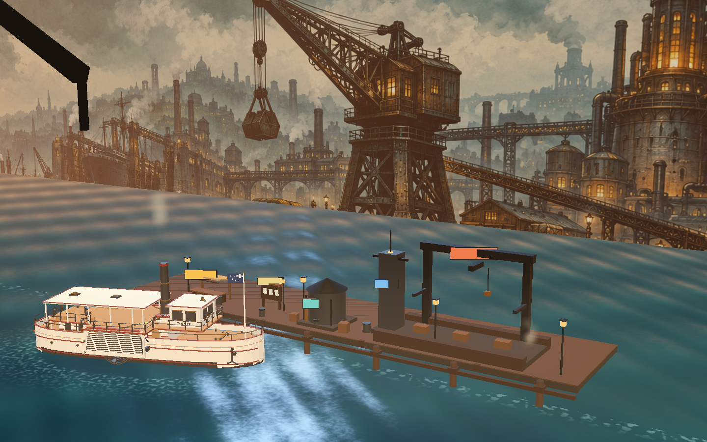
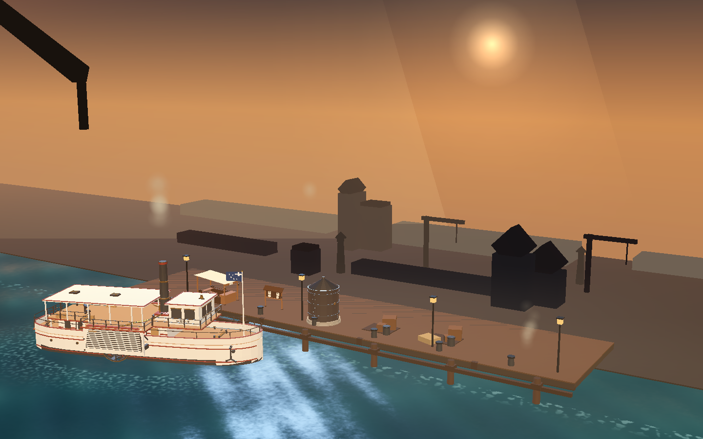
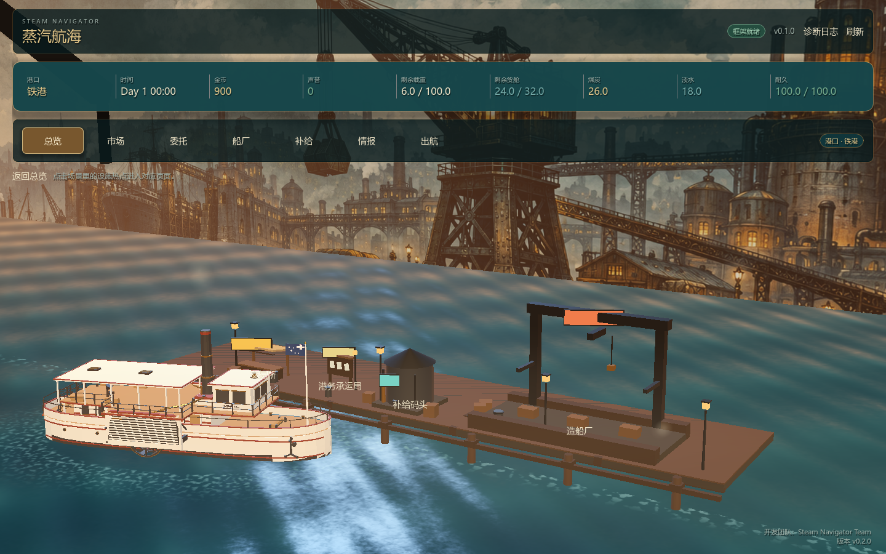
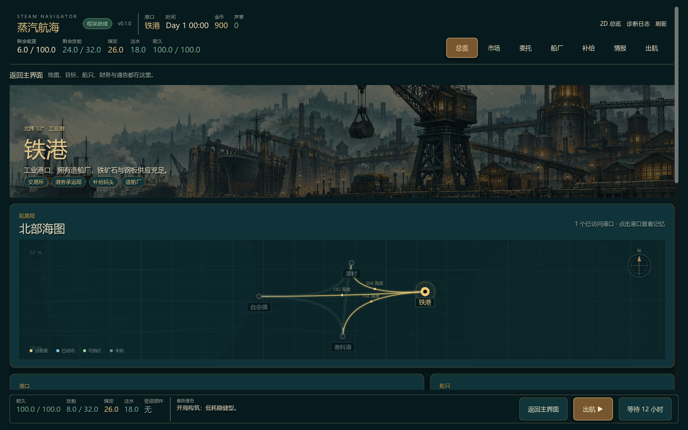
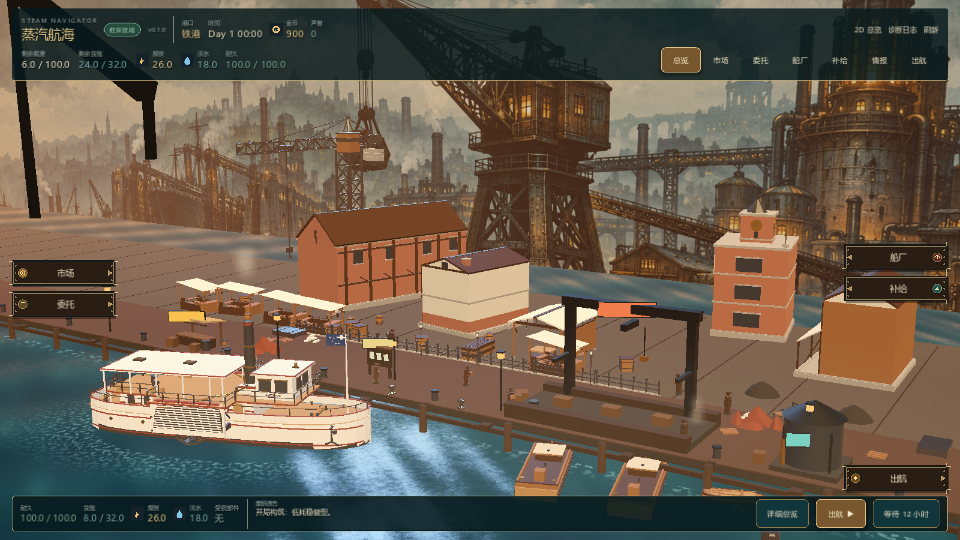
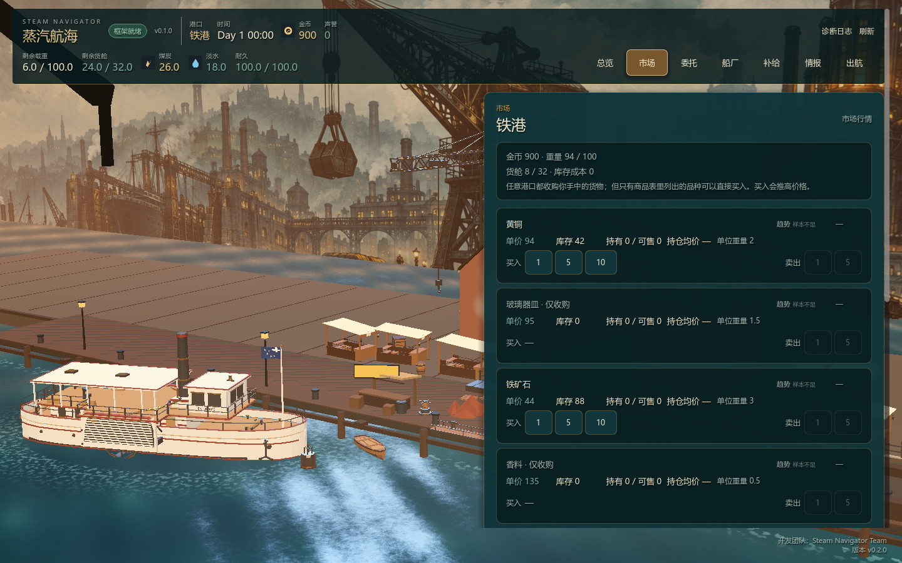
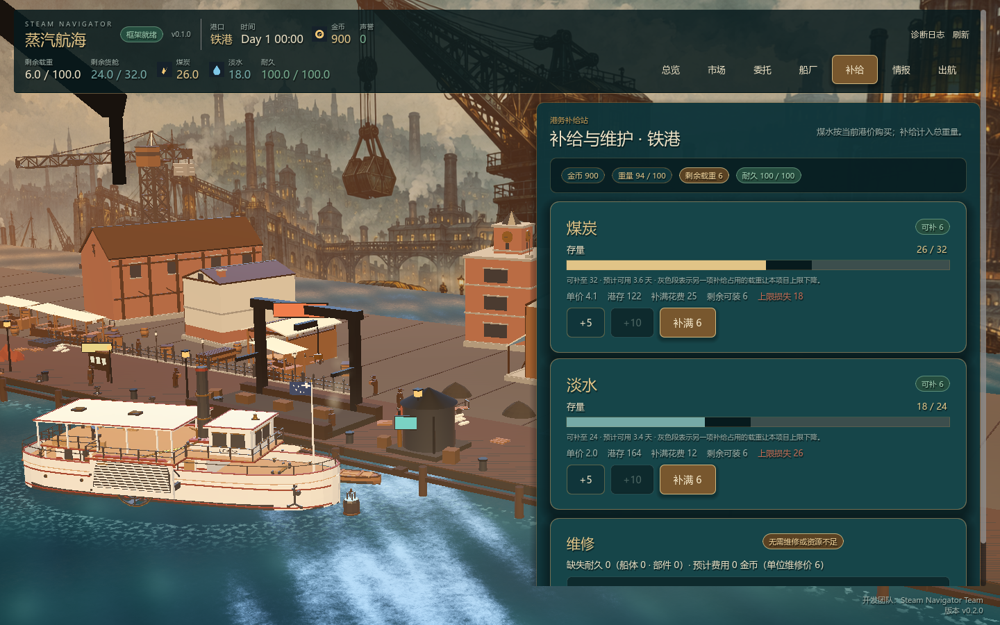
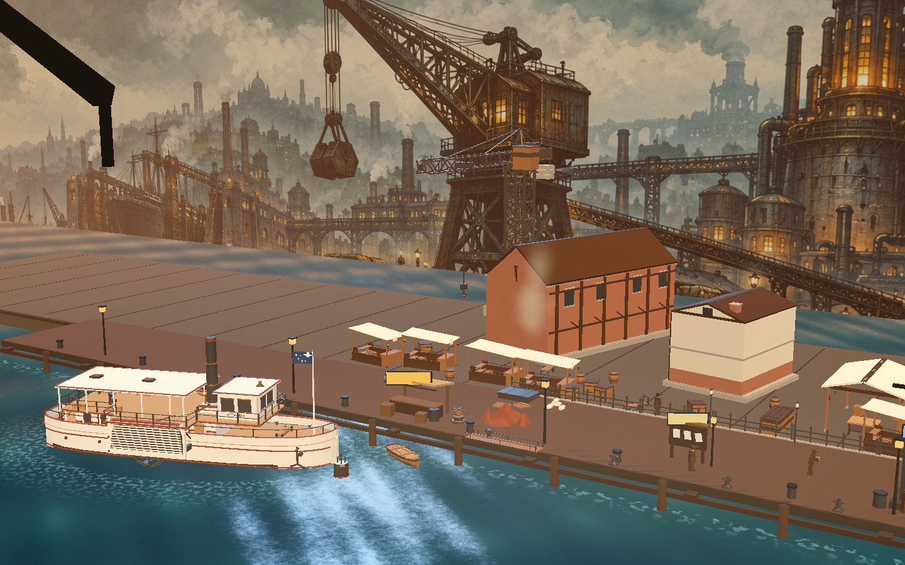

# 2.5D 固定舞台升级方案

> 状态：**阶段 1 的前七个切片已落地（船厂 3D → 通用 StageHost + PortStage 骨架 → 总览页背景层 + 2D 热点 → 场景填充 L0–L2/L6/L7 → Bounty Train 式主界面 HUD + 港口街景 kit/diorama → 主界面美术收尾 + 街景密度 + 性能回收 → 连续港区 + 港务/市场/补给相邻站位）**，其余舞台仍按本方案排期。  
> 已实现：`SNShipStage3D` 通过 `SNShipView.set_renderer()` 接入船厂正常态；2D HUD、槽位、拖拽与改装态纵剖图全部保持原样；3D 资产缺失时自动回退程序化占位。  
> 第二切片已落地：`SNStageHost` + `LocationStage` 通用宿主契约、`ShipyardStage` 迁移、`PortStage` 港口骨架（L0–L5 分层、设施锚点/空槽/GLB 替换/billboard 回退）与独立预览场景。  
> 第三切片已落地：总览页全窗 `PortStage` 背景层 + 2D 设施热点 + 俯瞰/返回切换，加载失败回退 2D。  
> 第四切片已落地：L0 暖色天空/太阳光晕、L1 无 banner 时 3 层程序化 painted backdrop、L2 双深度带 MultiMesh 剪影、L6 前景框、L7 蒸汽/雾；全程序化、无新资产，预算 ≤120 draws / ≤60k tris。  
> 第五切片已落地：总览默认 3D 主界面、121 px 紧凑 chrome、左右设施招牌 + 出航招牌、60 px 底部状态条、详细总览抽屉、2D 回退；港口街景 10 件 `SN_HT_*` 与 `port.diorama`/`town_visuals` 接线（旧存档按 archetype 回填）。  
> 第六切片已落地：HUD 资源 chip 图标化（`AssetService.find_key()` 裸键解析）、自绘木牌/铁框/黄铜铆钉招牌 + 设施徽记与悬停光晕、960×540 窗口缩放验收；港口街景 normal 29→47 件（按 `port.size`/`diorama.density`，sparse 28 / busy 63）、设施+街景+玩家船静态合批（实测 preview 63 / sparse 56 draw calls，37k/30k tris）、无 banner 港口 3 层程序化远景（1 个 MultiMesh）；1440×900 与 960×540 截图验收。  
> 第七切片已落地：港口改为**连续港区**（Bounty Train 式「场景相邻，切场景只移动玩家的船和镜头」）——160 m 连续码头上市集 / 港务 / 补给三个相邻站位；新增 `PortStage.focus_station()/advance_station()`，切页只在 0.6 s 内平移镜头并把玩家船开到新泊位（转艏 + 24 m/s 沿岸航行），港口世界与合批层不重建，泡沫环随船移动；市场/补给页改为右侧 640 px 泊位面板、左侧保留 3D 街景，站位间页面切换不播黑场淡出。  
> 出航进港演出、委托/情报页舞台化、质量档位与 L2 LOD 仍待做；**LOD1 资产已就位**（M0-5：kit 26 + 船 4 + 建筑 8 个 LOD1），运行时切换仍未接线，见 §7 与 [LOD1_BASE_KIT_ACCEPTANCE.md](../archive/LOD1_BASE_KIT_ACCEPTANCE.md)。  
> 启动条件（其余舞台）：玩法闭环稳定、存档/回归测试稳定、3D 模型与港口资产达到最低可用量。  
> 参考方向：《赏金列车 / Bounty Train》的固定机位场景与场景切换，而不是自由 3D 世界。

## 1. 结论

《蒸汽航海》的 2.5D 不升级成 3D 玩法，而是升级为：

> **2D 经营 UI + 固定机位的 3D 港口/船只舞台 + 舞台间切换。**

玩家始终在一个“当前港口舞台”里；市场、船厂、补给、出航是不同构图和机位的舞台，不是一张可自由行走的大地图。

主港口可以保留**有限环绕**作为看船功能；其他场景保持固定机位，避免相机、构图、点击热区和 UI 互相打架。

## 2. 目标与非目标

### 目标

- 让船和港口成为可感知的空间，而不是纯背景图。
- 用固定机位保证每个场景的构图、可读性和美术质量。
- 场景切换像舞台换景，不像打开一个完全无关的页面。
- 3D 只做表现层，不接管贸易、航行、存档等规则。
- 复用现有 UI、Theme、QueryBus / CommandBus 和内容模组架构。

### 非目标

- 不做可自由行走的 3D 港口。
- 不做自由飞行相机或全 3D 海图。
- 不把贸易/航行规则迁进 3D 节点。
- 不在本轮解决“大世界无缝加载”。
- 不要求每个港口一开始都有完整独立 3D 场景。

## 3. 体验形态

```text
当前港口：PortStage（同一连续港区的相邻站位，切页只移动船和镜头）
  ├─ 总览 → Harbor 站位（港务正面：委托/情报/船厂入口）
  ├─ 点击市场 → 镜头平移到 Market 站位 + 船驶到市场泊位（右侧泊位面板）
  ├─ 点击补给 → 镜头平移到 Supply 站位 + 船驶到补给泊位（右侧泊位面板）
  ├─ 点击船厂 → 独立 ShipyardStage（干船坞构图）
  └─ 点击出航 → 离港镜头 → 2D 海图 → 进港镜头 → 目的港 PortStage
```

顶部导航仍然是主导航；场景内的码头标牌/箭头只是同一意图的“场景化入口”，不能成为唯一导航方式。

### 场景清单

| 舞台 | 机位 | 主要内容 | UI |
| --- | --- | --- | --- |
| `PortStage` | 固定 3/4 俯视，可选有限环绕 | 船、码头、起重机、仓库、灯塔、水面 | 顶部 HUD + 总览面板 |
| `MarketStage` | 同港区 Market 站位（固定 3/4） | 市场棚、货箱、秤、NPC 剪影 | 右侧泊位面板（市场表格） |
| `ShipyardStage` | 固定侧视/3/4 剖切 | 干船坞、船体、模块 socket、起重机 | 船厂/模块面板 |
| `SupplyStage` | 同港区 Supply 站位（固定 3/4） | 煤堆、水箱、维修台、仓库 | 右侧泊位面板（补给卡/维修报价） |
| `VoyageTransition` | 相机升高/降低 + 2D 海图 | 离港、航线移动、事件、进港 | 时钟、事件卡、跳过按钮 |
| `MainMenuStage` | 可后置 | 港口远景/船停靠 | 主菜单 |

## 4. 相机规则

### 主港口

- 默认固定 3/4 机位，镜头不主动移动。
- 玩家在**空白舞台区域**拖动时，允许固定俯角的有限 yaw 环绕，建议 `±40°～±60°`。
- 不允许改变俯角，不允许穿入船体或地面。
- UI 面板打开时锁定相机；鼠标在 UI 上时不触发环绕。
- 双击/按钮回到默认机位。
- 环绕只作为“看船”功能，不是其他场景的通用相机。

### 其他舞台

- 全部固定机位，不允许绕场景旋转。
- 只允许轻微的入场推镜、idle 呼吸、粒子/水面/烟雾动画。
- 镜头、灯光、前景遮挡都在舞台 `.tscn` 内预置。

### 投影建议

- 优先**正交相机**，更接近 2.5D 立体插画/模型摆件。
- 如果使用透视，宜用长焦低 FOV，避免近大远小破坏 UI 构图。
- 每个舞台固定 `orthogonal_size`，适配 16:9；960 宽下允许裁切边缘，不裁掉可交互热点。

## 5. 架构

```text
GameView (Control)
├── StageHost (SubViewportContainer)
│   └── SubViewport (transparent_bg, own_world_3d)
│       └── active LocationStage (Node3D)
├── HUD (Control)             顶部导航、资源条、时间
├── ScreenUI (Control)        市场/委托/船厂等页面
└── TransitionLayer (Control) 舞台切换遮罩
```

### 5.1 StageHost

- 只负责承载当前 3D 舞台和渲染目标。
- 一个页面同一时间只开一个 3D 舞台。
- 页面隐藏/离开时停止更新，避免后台渲染。
- 建议配置：
  - `SubViewport.transparent_bg = true`
  - `own_world_3d = true`
  - `render_target_update_mode = UPDATE_WHEN_VISIBLE`
  - `SubViewportContainer.stretch = true`
  - 3D 视口分辨率可低于 UI，例如 0.75×，通过 `stretch_shrink` 控制

### 5.2 LocationStage 契约

每个舞台是独立 `.tscn`，根节点统一脚本：

```gdscript
class_name LocationStage
extends Node3D

signal portal_requested(target_id: String)

@export var stage_id: String = ""

func enter(payload: Dictionary) -> void:
    pass

func exit() -> void:
    pass

func bind(view_model: Dictionary) -> void:
    pass
```

- `enter/exit` 只处理舞台内的相机、灯光、动画和局部状态。
- `bind` 只接收 ViewModel；不访问 CommandBus，不写 GameState。
- `portal_requested` 只表达玩家意图，由 StageDirector/Shell 决定跳转。

### 5.3 StageDirector

```text
StageDirector
├── load_stage(stage_id, payload)
├── preload_stage(stage_id)
├── change_stage(stage_id, transition)
└── current_stage()
```

职责：

- 舞台场景加载/卸载/预加载。
- 过渡遮罩和相机切换。
- 目的地舞台的线程预加载。
- 失败回退到 2D 背景。

不建议让每个 UI 页面自己持有 3D 相机或直接 `change_scene_to_file()`。

### 5.4 点击热区

固定机位下优先使用 **2D Control 热点**，而不是 3D 碰撞拾取：

- 码头入口、市场招牌、船厂入口是屏幕坐标上的透明 Button/TextureButton。
- 热点坐标随 StageHost 同尺寸锚定，不在 3D 世界做 RayCast。
- 好处：不受透明物体、粒子、模型层级影响；键盘焦点和本地化提示也更容易做。
- 3D 模型内部不需要碰撞体。

## 6. 出航与进港

### 6.1 时间线

| 时间 | 表现 | 状态 |
| --- | --- | --- |
| 0.0s | 玩家确认出航，命令提交 | 游戏时间和事件已确定 |
| 0.0–0.8s | 港口舞台相机升高，港口淡出 | 表现层计时开始 |
| 0.6–1.2s | 2D 海图淡入 | 3D 舞台隐藏 |
| 1.2–3.5s | 小船沿航路移动，时钟快速推进 | 只读播放 |
| 事件点 | 停在小船位置，弹出事件卡 | 等待玩家选择 |
| 抵达前 | 海图淡出，目的港预加载 | 读取 arrival 数据 |
| 抵达 | 目的港舞台相机从高空降到固定机位 | 舞台 enter |
| 结束 | HUD 恢复，PortStage 可交互 | 状态已落地 |

### 6.2 关键规则

- **命令先提交，演出后播放**：`voyage.start` / `event.choose_option` 已经决定状态，动画只读取结果。
- **表现层时钟**只用于顶部时间显示和进度，不能回写 GameState。
- 事件发生时暂停航路标记；事件选项结算后继续到抵达或下一个事件。
- 必须支持“跳过演出”：直接落到最终状态，不跳命令。
- 演出期间禁用存档/读档，或保证快照一致。
- 目的港舞台在航行阶段线程预加载，避免读条。
- 进港时 3D 场景从高空落下，与海图用云层/暗角/淡出遮罩衔接，不需要 3D 与 2D 几何真正连续。

## 7. 3D 资产约定

沿用 [MODELING_WORKFLOW.md](MODELING_WORKFLOW.md) 的建模流程，并补充：

- 单位米，Blender +X 为船首、+Z 向上；Godot 导入后按现有约定绕 Y 轴修正。
- 船体轴心在中部水线；道具轴心在地面中心。
- GLB 不导出 Blender 相机和灯光；相机/灯光属于 Godot Stage。
- 船体预留 socket：
  - `SN_Socket_Engine`
  - `SN_Socket_Cabin`
  - `SN_Socket_Navigation`
  - `SN_Socket_Safety`
- 港口使用模块化资产：码头段、起重机、仓库、灯塔、市场棚、煤堆、水箱。
- 低模、平直着色、3–5 个材质、优先调色板而不是贴图。
- 至少准备 `LOD0/LOD1` 或 `visibility_range`；远景港口不加载高模。
  - **LOD1 资产已交付（M0-5，2026-10-22）**：kit 26 + 4 艘可玩船 + 铁港建筑 8 栋共 **38 个 LOD1**（kit / 船 30 件 19,850 tri；建筑 8 个 LOD1），可直接被质量档位 / `visibility_range` 使用；**运行时 LOD 切换与质量档位仍未接线**（见 [LOD1_BASE_KIT_ACCEPTANCE.md](../archive/LOD1_BASE_KIT_ACCEPTANCE.md)、[todo.md](../../todo.md)）。
- 每个舞台的 3D 预算单独记录，避免一个页面多个视口。

### 数据映射

```json
{
  "port_id": "port_0",
  "stage_scene": "res://framework/ui/stages/port_stage.tscn",
  "diorama_id": "harbor.iron",
  "ship_visual_id": "ship.small_efficient"
}
```

- 内容包优先只提供数据与资产键，舞台场景先放在框架/官方 UI 目录。
- 模组自带 `.glb` 需要单独评审内容白名单；不要让任意模组随意加载场景脚本。
- 视觉缺失时回退现有 2D banner/船图，不阻断玩法。

### 内容资产交付：全部走模组（2026-10 起）

游戏本体 PCK 只保留**框架资源**：代码、Theme/字体、UI 外壳图、音频、水面 shader/材质/噪声贴图。

**内容资产全部随 core 模组发布**，本体不打包：

| 资产 | 归属 | 路径 / 键 |
| --- | --- | --- |
| 船体模型 | core 模组 | `dev_mods/core/assets/models/ships/*.glb`，键 `model.ship.*` |
| 模块/道具/货物模型 | core 模组 | `dev_mods/core/assets/models/{modules,props,goods,materials}/`，键 `model.*` |
| 港口横幅/图标 | core 模组 | `core/assets/ports`、`core/assets/icons`，键 `banner.*` / `icon.*` |
| 3D 舞台场景、机位、灯光、水面 | 框架 | `framework/ui/...` 与 `assets/{shaders,materials,textures}/water` |

运行时加载链路：

- `export_presets.cfg` 的 `exclude_filter` 已加入 `assets/models/*`，导出包不再包含内容模型。
- `AssetService.load_texture()/load_model()` 是统一入口：先 `resolve()` 到物理路径；框架资源走 `ResourceLoader`，模组内原始 `.png/.glb` 走 `ContentAssetLoader`（`Image.load_from_file` / `GLTFDocument.append_from_file`）。
- 船体 3D 模型不再按 `hull_tier` 硬编码路径，而是读船体定义的 `information.model` 资产键（`model.ship.*`）；解析不到才回退旧路径/程序化占位。
- 港口横幅同样通过 `banner.port.*` 资产键从模组加载，直接读原始 PNG。

新增内容资产的做法：放进 `dev_mods/core/assets/models/<category>/`，在 `dev_mods/core/manifest.json` 声明 `model.<category>.<name>`，然后 `pwsh tools/pack_core.ps1`；**不要**再放到 `res://assets/models`（那目录已不进发布包）。

### 场景填充与远景（固定机位的构图预算）

固定机位意味着**只填一个取景框**：镜头永远看不到的背后与侧面不建，画面内每个像素都属于下面某一层。缺内容时不是“留黑”，而是用雾、水面、云做刻意的空。

| 层 | 内容 | 实现 | 交互 |
| --- | --- | --- | --- |
| L0 天空 | 渐变天空、太阳/月亮光晕、云带 | `WorldEnvironment` 程序化天空或 Sky shader + billboard 云 | 无 |
| L1 远景剪影 | 山体、城市天际线、灯塔、要塞 | unshaded 低模或烘焙背板 + 雾，不做细节 | 无 |
| L2 中景岸线 | 岸壁、仓库群、轨道、烟囱、塔吊群 | 模块化 kit（`LOD` / `visibility_range`） | 无（热点在 2D） |
| L3 港口设施 | 码头、市场棚、煤堆、水箱、系缆桩、货箱 | 复用现有港口道具资产 | 2D 热点 |
| L4 水面 | 波动水面、泡沫、航迹 | `harbor_water` shader | 无 |
| L5 船只/漂浮物 | 玩家船、停泊船、驳船、小艇、浮标、海鸥、浮木（门面港 = 玩家船 + 2 rowboat + 1 cargo_lighter） | GLB 或 billboard | 玩家船可检视 |
| L6 前景框 | 吊机臂、桅杆、雨棚、缆绳、蒸汽 | 单面片/低模，压暗边缘 | 无 |
| L7 大气与遮罩 | 雾、蒸汽、雨、暗角 | 粒子 + 屏幕后期/遮罩 | 无 |

原则：

1. **镜头外不建**；可见边界用雾、海岸线、前景框收住，不出现空黑背景。
2. **远景不交互、不投影阴影**；中景只保留轮廓，细节预算给近景设施与船。
3. **视差用静态构图替代**：远景几乎不动、中景轻微晃动，只有 idle 呼吸、旗帜、蒸汽与水面在动。
4. **远景可先用 2D 背板兜底**：现有 5 张港口 banner 可以直接烘焙成 L1 远景，验证构图后再逐张替换为 3D 剪影，避免一次性建模拖延。
5. **天空/雾/天气由数据决定**：来自 `weather_profiles` 与港口调色，不在运行时随机换天，避免同一港口两次进港气质不同。
6. **空要刻意**：留水面、雾、云和远帆，不要留“未填充的黑色盒子”。

数据映射扩展（`diorama` 块，可选字段，缺省回退默认 kit）：

```json
{
  "kit": "harbor.coastal",
  "backdrop": "backdrop.iron_coast",
  "sky": "sky.temperate_dusk",
  "shore_kit": "shore.coastal",
  "foreground_frame": "frame.crane_arm",
  "animated": ["steam", "gulls", "flags"],
  "density": "sparse|normal|busy"
}
```

- `backdrop` / `shore_kit` / `foreground_frame` 都是官方 kit id，第三方只能换 `facility_visuals` 与 `backdrop` 的道具资产，不能改构图。
- `density` 控制 L2/L5 的实例数量，低配与 960 宽可降档，不影响可交互设施。

第一版预算（单舞台，1440×900）：

- draw call ≤ 120，三角面 ≤ 60k；`L0` 0–1、`L1` 1–3、`L2` 8–20、`L3` 10–30、`L4` 1、`L5` 1–6、`L6` 2–4 个实例，粒子系统 ≤ 3。
- 远景与前景框全部 unshaded/无阴影；只有玩家船与近景设施接收主光。
- 门面（landmark）模式例外：terminal 资产自身 59,450 tri，整场景 tri 必然超 60k（draw calls 仍在 ≤120 内），见第九切片；terminal 的 LOD1 或门面模式专属 tri 预算列入后续。

填充优先级（先让画面“成立”，再让画面“好看”）：

1. L0 天空 + L1 远景背板（先 2D banner 烘焙）→ 消除空黑。
2. L2 中景岸线 + L4 水面收边 → 形成港口空间。
3. L5 停泊船/浮标/海鸥 → 增加生活感。
4. L6 前景框 → 增强纵深与压边。
5. L7 蒸汽/雾/雨 → 最后做氛围。

验收：固定机位截图逐层检查，7 层都有内容或刻意的空；960 宽下不出现空黑；前景框不遮挡 HUD 与 2D 热点。

## 8. UI 约定

- 顶部导航和资源 HUD 始终保持，场景切换不重建整个页面。
- 3D 舞台是背景层；2D 面板放在上方，但要有足够的暗角/半透明底板保证可读性。
- 市场表格、委托卡、船厂面板继续使用现有 Theme 与组件。
- 场景内的入口/箭头是辅助导航，不能替代顶部导航。
- 960 宽下允许隐藏场景边缘装饰，但价格、持仓、操作按钮必须保留。
- 降低动态效果设置应能关闭环绕、粒子、相机推拉，保留静态舞台。

### 设施锚点（哪些必须建模）

设施是玩法功能，视觉上只需要**锚点道具 + 1–2 个辅助件 + 图标招牌**；不做完整建筑、不做室内、不做碰撞。点击命中继续用 2D 热点（见 §5.4）。

第一批建模工单与逐件规格：[PORT_FACILITIES_PLAN.md](../../tools/modeling/briefs/PORT_FACILITIES_PLAN.md) / [sn_port_facilities_batch1.json](../../tools/modeling/briefs/sn_port_facilities_batch1.json)。

| 设施 | 锚点模型（必备） | 辅助件（复用/可选） | 预算 |
| --- | --- | --- | --- |
| `exchange` | 市场棚 / 交易亭 | 货箱、遮阳布、秤、吊牌 | 3–6k tri / 2 材质 |
| `contracts` | 告示板 | 路灯、纸张 billboard、长椅 | 1–2k tri |
| `supply` | 煤堆 + 水箱 | 输煤槽、水管、吊桶 | 2–4k tri |
| `shipyard` | 干船坞 / 滑道 + 龙门吊 | 船体分段、脚手架、工具车 | 5–10k tri |
| `intel` | 信号塔 / 旗语杆 | 望远镜、灯、地图台 | 2–4k tri |

明确不建：

- 室内、柜台内部、NPC 个体（用剪影或 billboard 代理）。
- 招牌上的本地化文字（3D 用图标/纹样；文字交给 2D 标签层，避免每种语言一套贴图）。
- 设施背面与镜头不可见面；不做碰撞体，不做可进入门。
- 远景仓库群只做剪影（见 §7 场景填充 L2）。

空槽位规则：`facilities` 未包含的设施**不得出现锚点模型**，用“通用岸线 / 货堆 / 空场”填充；不允许“模型有船厂但数据没有”。同一港口 `size` 决定槽位数量与锚点尺度，`palette` 决定材质色调，`landmark` 是唯一允许的港口专属定制件（最多 1 个）。

资产与模组边界：

- 五个锚点属于官方 core kit，随版本发布；第三方只能通过 `facility_visuals` 把某个设施替换为白名单内单文件 GLB，不能新增设施类型或改变槽位布局。
- 替换件必须满足尺寸/轴心/三角面/材质数约束，缺失或不合规时回退官方锚点并给 `warning`。
- 每个锚点两级 LOD：近景全模、远景剪影 unshaded；编辑器用现有 GLB 缩略图流程选择。

## 9. 性能与质量

- 同一时间只渲染一个 3D 舞台。
- 隐藏舞台立即停更新，不保留后台 SubViewport。
- 3D 分辨率可低于 UI；优先保证 60fps。
- 一个主方向光 + 一个补光；实时阴影默认关闭，用 blob/接触阴影替代。
- 烟雾、蒸汽用低数量 GPUParticles；水面用简单材质/法线动画。
- 舞台切换用预加载 + 遮罩，不做同步大资源加载。
- 验收至少覆盖 1440×900、1280×720 和 960 宽窗口。
- 导出 Windows/Linux 后实测，不只 headless。

## 10. 风险

| 风险 | 应对 |
| --- | --- |
| 每个场景独立布景导致资产爆炸 | 先做 3 个舞台，共用港口资产库；独立室内后置 |
| 固定机位显得像菜单 | 加场景内热点、短推镜、音效、环境动画，但保持固定构图 |
| 主港口环绕与其他场景冲突 | 环绕只限当前港口，且面板打开时锁定 |
| UI 挡住 3D 热点 | 热点用 2D Control 固定坐标，避免 3D 拾取 |
| 出航演出与状态不同步 | 命令先提交，演出只读；跳过和事件走同一状态机 |
| 进港卡顿 | 航行期间预加载目的港 Stage；失败回退 2D |
| 低配性能不足 | 单舞台、低分辨率 3D、关闭阴影/粒子、质量档位 |
| 模组 3D 资产安全 | 先只允许官方资产；第三方 `.glb` 单独评审白名单 |

## 11. 分阶段计划（阶段 1 已启动）

### 实现进度（2026-10）

阶段 1 的首个切片已完成，验证了「3D 舞台 + 2D HUD」这条路线在当前架构里可行：

- [framework/ui/components/sn_ship_stage_3d.gd](../../framework/ui/components/sn_ship_stage_3d.gd)：首个切片的 `SubViewportContainer + SubViewport + own_world_3d` 3D 船厂舞台，按 `hull_tier` 选 `assets/models/ships/*.glb`，动态取包围盒做固定 3/4 机位取景；复用 `assets/materials/water/harbor_water.tres` 水面着色器，并把船体泡沫环参数绑到当前船体包围盒。**（第二切片已把这段实现迁入 `SNStageHost` + `ShipyardStage`，该文件现在只是 renderer 协议适配器。）**
- [framework/ui/screens/port/shipyard_screen.gd](../../framework/ui/screens/port/shipyard_screen.gd)：正常态挂载 3D 舞台；改装态隐藏 3D、继续用纵剖图贴图；2D 槽位卡、拖拽、分类页签与所有命令路径未改。
- 回退策略：`SNShipStage3D.is_supported()` 为 false（没有可用船体 GLB）时不创建视口，保持 `SNShipView` 程序化占位，导出包与 CI 都不依赖新资产。
- 测试：`test_shipyard_refit` 的 renderer 用例同时覆盖「有 3D 资产 → 默认挂载、改装态隐藏」与「无资产 → 保留占位」两条分支。


### 第二切片：通用舞台宿主 + 港口骨架（2026-10）

第二切片把首个切片里「视口 + 机位 + 灯光 + 水面」的样板逻辑收成可复用基础设施，并交付舞台切换到港口所需的宿主、契约与港口骨架：

- [framework/ui/stages/location_stage.gd](../../framework/ui/stages/location_stage.gd)：舞台契约（`stage_id`、`enter/exit/bind`、`has_visual`、`hotspot_anchors`、`portal_requested`）；舞台自持相机/灯光/环境/水面/道具与 idle 动画，只读已解析 ViewModel，不访问 GameState / QueryBus / CommandBus。
- [framework/ui/stages/stage_kit.gd](../../framework/ui/stages/stage_kit.gd)：共享构建器（程序化天空/颜色环境、无阴影方向光、近/远水面材质、AABB 与长焦取景、船体泡沫环）；水面材质 `duplicate` 后写参数，不污染共享资源。
- [framework/ui/components/sn_stage_host.gd](../../framework/ui/components/sn_stage_host.gd)：`SubViewportContainer` 宿主，独占 `SubViewport`/`World3D`；`load_stage/mount_stage/unmount_stage` 驱动 `enter → bind` 生命周期，发 `stage_mounted/unmounted/portal_requested/fallback_requested`；隐藏即停 viewport 更新与舞台 processing，`render_shrink` 控制 3D 渲染分辨率。
- [framework/ui/stages/shipyard_stage.gd](../../framework/ui/stages/shipyard_stage.gd)：船厂舞台的迁移目标；船体路径优先级 `hull_model_path` → `hull_tier` 旧路径 → `SN_Ship_Prototype.glb`，无模型时舞台保持空、船厂继续用 `SNShipView` 程序化占位。`SNShipStage3D` 重写为只保留 `SNShipView` renderer 契约的宿主适配器。
- [framework/ui/stages/port_stage.gd](../../framework/ui/stages/port_stage.gd)：港口骨架；`facilities` 决定 L3 设施（有 `facility_visuals` GLB 则替换，否则程序化 billboard；缺席只放货堆 filler、不生成锚点/热点）；L0 暖色程序化天空、L1 banner 背板（缺失不放黑盒：painted backdrop 兜底）、L2 双深度带 MultiMesh 剪影（仅无 banner）、L5 玩家船随波；码头为薄甲板桩基栈桥（入水木桩/桩帽/横梁），远景岸线底座 500×110 藏住水面切边；`port.size` 缩放设施层；`facility_anchors()` / `facility_screen_anchor()` 为 2D 热点准备世界/屏幕坐标。L6 前景框与 L7 蒸汽/雾由第四切片补齐。
- 预览与验收：[dev_scenes/port_stage/port_stage_preview.gd](../../dev_scenes/port_stage/port_stage_preview.gd) 提供 `preview`/`sparse` 两份样例；`tools/godot/capture_port_stage.gd` 窗口 1440×900 截图；`test_stage_host.gd` 9 个同步用例守护 LocationStage 契约、宿主生命周期/回退/停更、ShipyardStage、SNShipStage3D 与 PortStage 装配/替换/缩放/portal。





### 第三切片：总览页背景层 + 2D 设施热点（2026-10）

第三切片把 `PortStage` 接到可玩界面：总览页可在 2D 总览与全窗 3D 港口舞台之间切换，设施用相机投影的 2D 热点进入对应页面。

- [framework/ui/shell/main.gd](../../framework/ui/shell/main.gd)：`PORT_STAGE_SCENE_PATH` / `PORT_STAGE_FACILITY_SCREENS`；全窗 `SNStageHost` 挂在 `Background` 之上、所有 UI 之下，热点层在 `PageMargin` 之后；`_sync_port_stage()` 按「有 run / 非在航 / 总览页 / stage 模式 / 场景可用」显示，`_hide_port_stage()` 在菜单、无 run、通关、在航与错误分支统一隐藏并清空热点。
- 切换与回退：`_on_overview_stage_toggle()` 只改 UI 会话状态 `_overview_stage_mode`；`_port_stage_available()` 懒判场景存在，`_on_port_stage_fallback()` 加载失败后本会话不再重试、回退 2D 并提示 `ui.error.port_stage_unavailable`。
- 2D 热点：[framework/ui/screens/port/overview_screen.gd](../../framework/ui/screens/port/overview_screen.gd) 发 `stage_toggle_requested`（按钮「俯瞰港口 / 返回总览」）；Shell 用 `facility_anchors()` → `facility_screen_anchor()` 投影生成 136×36 `SNGhostButton`，`PORT_STAGE_FACILITY_SCREENS` 映射 market/contracts/supply/intel/shipyard，点击与顶部导航同一路径；`_refresh_port_hotspots_soon()` 两次 deferred 等容器布局与 SubViewport 尺寸，视口 size_changed 时重排。
- 测试/截图：`test_ui_shell` 真实外壳用例覆盖切换→挂载→设施/船/热点数→离开隐藏→返回恢复→关闭；`ui_snapshot.gd --overview-stage` + `capture_ui.ps1 -OverviewStage` 产出 `overview_port_stage.png`。



### 第四切片：场景填充 L0–L2 / L6 / L7（2026-10）

第四切片把港口舞台从「骨架成立」推进到「构图有层次」，全部程序化、不新增贴图资产：

- **L0 天空**：`ProceduralSkyMaterial` 暖色调参（`sky_energy_multiplier=1.12`、`sun_angle_max=18`、`sun_curve=0.22`）+ 暖 key；无 banner 时追加 2 个 additive radial 太阳光晕（`SunHalo` 90 m / alpha 0.12、`SunCore` 18 m / alpha 0.62，radial 纹理 72% 半径淡出）。
- **L1 远景**：有 `banner_path` 继续用 banner 背板；无 banner = 暖霞渐变 `SkyCard` + 双太阳光晕 = 3 层程序化 painted backdrop，`has_backdrop()` 仍只表示 banner。目前官方内容只有铁港一张 banner，其余港口都走这条常规路径（原计划的「5 张 banner 烘焙」不再需要）。
- **L2 岸线（仅无 banner）**：双深度带（近带深蓝灰 / 远带暖雾）各 2 簇 + 低矮仓房连接排 + 远岸低雾带 + 灯塔剪影；MultiMesh 批量（box / 塔身 / 塔冠 3 draw）、严格站 `SHORE_TOP`、无阴影/发光窗；建筑数 small 7 / medium 10 / large 13、吊机 2/2/3（实例数约 14/17/20，控制在方案 L2 ≤20 预算内）。
- **L6 前景框**：吊臂 0.30 / 钢缆 0.12 / 桅杆 0.18 m 三根深色构件从左上角入镜（`_screen_point` 固定在画幅、u<0.24 / v<0.45），不遮挡 HUD、设施招牌与热点标签。
- **L7 大气**：3 个 `GPUParticles3D`（船烟囱 / 码头排气 / 岸线烟囱，16–22 粒、3.4–4.6 s、低 alpha 暖灰 + 程序化 radial 贴图）+ 雾带（有 banner 2 层 / 无 banner 3 层，`port.id` hash 相位、正弦漂移）；宿主停更时一起停。
- **预算与自查**：preview ≈114 draws / 17,954 tris，sparse ≈73 / 19,228（≤120 / ≤60k）；新增 5 个只读访问器（`foreground_frame` / `atmosphere_particle_systems` / `atmosphere_layers` / `skyline_building_count` / `skyline_crane_count`）供测试与 960 宽自查；`dev_scenes/port_stage/` 预览脚本打印层级数量、前景框屏幕 bbox 与预算明细。


### 第五切片：Bounty Train 式主界面 + 港口街景 kit + diorama 接线（2026-10）

第五切片把总览从「3D 背景 + 浮标签」推进到可玩的主界面，并把港口街景资产接入内容管线：

- **主界面 HUD**：[framework/ui/shell/main.gd](../../framework/ui/shell/main.gd) 默认 `_overview_stage_mode=true`，总览进入全窗 3D 舞台；顶部 2 行 121 px 紧凑 chrome（品牌/状态/版本 + 港口·时间·金钱·声望 + 剩余载重/货舱/煤/水/耐久/受损 + 7 导航 + 2D 切换/诊断/刷新），在所有 run 页面共用；2D 回退仍可用。
- **两侧招牌**：按 `facility_screen_anchor()` 投影 x 分左右列（左「设施 ▶」/右「◀ 设施」，172×42），同列按投影 y 排序、避让 chrome 与底部状态条；右下常驻「出航 ▶」；resize 重排，点击走既有 `_on_port_hotspot` 映射。
- **底部状态条 + 详细抽屉**：60 px 状态条（耐久/货舱/煤/水/受损/最新通告 + 详细总览/出航/等待 12h，仅总览显示）；`_overview_detail` 默认关闭，打开时用不透明 backdrop 覆盖舞台并复用原 2D 面板（含通关清单），关闭/离开总览/回退自动复位。
- **港口街景 10 件**：`dev_mods/core/assets/models/props/SN_HT_*.glb`（长/短仓库、港务楼、货棚、酒馆、围栏、2 工人、划艇、驳船，合计 6204 tri，预算 11500）；`sn_harbor_town_generator.py` 参数化真源，`export_town_glb.py` 导出；Verifier R1 修复划艇压条/酒馆挂灯/港务楼窗板后 passed。
- **diorama 接线**：core manifest 新增 10 个 `model.prop.*`（资产 65→75），五港 `diorama.kit/town`（10 kit 键 + 6 复用道具），`port_archetype.schema` 扩展 `diorama`；`map_generator` 持久化 `diorama`；`port.view` 输出 `diorama` 与解析后的 `town_visuals`（旧存档按 archetype 回填）；PortStage 的 L2b 在 `town_visuals` 存在时装配 29 件镇区道具（5 建筑/7 围栏/6 工人/8 装饰/3 船），建筑缺失回退 blockout，并跳过 L2 剪影。
- **测试/截图**：`test_stage_host` 17 例（含 town 满配/无 town/非法路径/port.view 端到端），`test_ui_shell` 覆盖默认 3D + chrome + 招牌 + 状态条 + 抽屉 + 回退；截图 [主界面](screenshots/overview_port_stage.png) / [详细总览](screenshots/overview_detail.png)。




### 第六切片：主界面美术收尾 + 街景密度 + 性能回收（2026-10）

第六切片处理第五切片留下的三类债务：HUD 仍为纯文字、招牌只有代码 StyleBox、draw call 超预算且无 banner 港口远景偏空。

- **HUD 图标化**：[framework/ui/shell/main.gd](../../framework/ui/shell/main.gd) 的 `_stat_chip()` 支持可选 `icon_key`；`_hud_icon()` 经 `AssetService.find_key()` 把裸键解析到任一已挂载内容包（不硬编码 mod 命名空间），`load_texture()` 失败或缺键时回退皮肤图标（`HUD_SKIN_ICONS`）。2026-10-28 图标轮后 HUD 只剩「图标 + 数值」单行 chip（字段名进 tooltip），早期内容 `icon.money/coal/water` 退役，图标统一来自 30 枚皮肤图标批次；金币/煤炭/淡水等出现在顶部 chrome 与底部状态条，纹理按 key 缓存。
- **主题化招牌**：[framework/ui/components/sn_harbor_sign.gd](../../framework/ui/components/sn_harbor_sign.gd) 新增自绘 `Button` 子类：木板/木纹/铁框/黄铜铆钉/四角包边 + 设施徽记（市场硬币/委托告示/补给水滴/情报灯塔/船厂船坞）+ 真正指向场景的箭头 + 悬停黄铜光晕；`text` 仍保留完整标签供测试/提示，`Button` 语义（focus/pressed/tooltip）不变。招牌固定 172×42、边距 20，1440 与 960×540 截图均完整可见。**窗口适配说明**：工程使用 `canvas_items` 拉伸（基准 1440×900）+ `expand` 宽高比，逻辑宽度在真实窗口中恒 ≥1440（960×540 → 1600×900、800×900 → 1440×1620），因此 HUD 与招牌按同一份完整布局整体缩放，不做“窄窗口删信息”的 compact 分支；960×540 截图验证的是缩放后不裁切、价格/持仓/操作按钮全部保留。
- **街景密度**：[framework/ui/stages/port_stage.gd](../../framework/ui/stages/port_stage.gd) 新增 `DENSITY_BY_SIZE` / `TOWN_COUNTS` / `TOWN_QUAY_SLOTS`：`port.density` → `port.diorama.density` → `port.size` 推导（small→sparse、medium→normal、large→busy），每组按 tier 取前缀；新增市场摊（檐棚）/吊车/麻袋堆/钢板堆/矿堆/托盘/跳板/系缆桩/绞盘/浮标 10 类槽位，全部复用 core manifest 已声明资产（无新模型/贴图），`port.id.hash()` 仅做确定性 yaw 抖动。normal = 5 建筑 + 7 围栏 + 7 工人 + 8 广场装饰 + 3 船 + 17 码头工业件 = **47 props**（sparse 28 / busy 63）。
- **静态与船体合批**：`_batch_static_meshes()` 在重建后把 `_facilities_root` + `_town_root` 合并——BoxMesh 走共享单位立方体 MultiMesh（按材质），其余 static mesh 按**材质签名**烘焙成每材质 1 个 `ArrayMesh`；透明/ShaderMaterial/`material_overlay`/非三角面/带法线贴图的材质安全跳过。玩家船在泡沫 AABB 计算后按 `_ship_root` 局部空间刚性合批（`_batch_ship_visual()`），`ShipBatches` 仍随船升沉；带 AnimationPlayer/Skeleton/粒子/透明/法线贴图的船体自动整船回退（`ship_visual_is_rigid()`）。`batch_stats()` 暴露 facilities/town 与 ship 的 batches / mesh / surface 前后计数，`ship_foam_bounds()` 供测试核对泡沫不受批处理影响。
- **实测**：窗口 1440×900（gl_compatibility）`RenderingServer.get_rendering_info`：preview **63 draw calls / 37,280 tris**（原 284），sparse **56 / 29,738**（原 255）；tris 在 60k 预算内，draw calls 从 130–143 降到预算内。批处理明细 preview 33 batches（11 MultiMesh + 22 材质）、facilities/town 139→34 mesh、238→34 surfaces；玩家船 32→9 mesh / 90→9 surfaces。
- **无 banner 远景**：`_add_fallback_backdrop()` 在暖霞 sky card + 双太阳光晕之外新增 3 层低对比 unshaded 剪影（山脊 / 远城塔楼 / 港口屋脊+烟囱），合并为 1 个 MultiMesh，有 banner 时整组隐藏；同时把旧斜置 sky card 改为固定 260 m 深度的 camera-facing quad，修掉右侧远景被遮断的问题。`painted_backdrop_layer_count()` 供测试与测量工具读取（有 banner 时为 0）。
- **测试/工具**：`test_stage_host` 新增密度随 size 与 `diorama.density` 缩放、可选 town slot 缺失、静态层合批、无 town 仍合批、无 banner 远景层、玩家船刚性合批 + 泡沫 AABB、非刚性回退等用例（162 tests 全绿）；新增 `tools/godot/measure_port_stage.gd`（窗口模式，输出真实 draw calls / primitives / 分层 surface / 合批与船体统计，headless 自动降级分析口径）；`test_ui_shell` 覆盖 HUD 图标、招牌组件与紧凑尺寸 helper。
- **截图**：[主界面 1440×900](screenshots/overview_port_stage.png) / [主界面 960×540](screenshots/overview_port_stage_960.png) / [详细总览](screenshots/overview_detail.png) / [完整港口](screenshots/port_stage/port_stage_preview.png) / [无 banner 稀疏港口（3 层远景）](screenshots/port_stage/port_stage_sparse.png)。




### 第七切片：连续港区 + 港务/市场/补给相邻站位（2026-10）

参考《赏金列车》的做法：所有场景是**相邻**的，切换场景只移动玩家的船和镜头，而不是换一张背景图。第七切片把港口从「总览一张 3D 图 + 其它页 2D」推进为一座连续港区：

- **连续码头与三个站位**：[framework/ui/stages/port_stage.gd](../../framework/ui/stages/port_stage.gd) 的码头从 54 m 延长到 **160 m**（19 组入水木桩、系缆桩每 12 m、前景煤气灯 7 根），抬升广场扩到 250 m；`STATIONS` 定义三个相邻站位（世界 X 从左到右）：
  - `market`（-30）：市集 / 摊位 / 货箱 / 木板围栏；
  - `harbor`（0）：港务正面（委托告示板 / 情报塔 / 船厂入口 / 港务楼）；
  - `supply`（+30）：煤水堆场（煤堆 / 矿堆 / 钢板 / 麻袋 / 吊车 / 龙门架）。
  `exchange` 与 `supply` 设施分别搬到 -30 / +30 的站位上，其余设施仍集中在中心段；每个站位的 `camera`/`target`/`ship`/`ship_yaw` 都在 `STATIONS` 里声明，三站位共用 30° 长焦，只改位置与目标。
- **切页 = 移动船 + 镜头**：`focus_station(station, framing, immediate)` 只重定向镜头与泊位，港口、街坊、设施、水面、合批层全部复用；`advance_station(delta)` 在 0.6 s 内平滑平移镜头，玩家船先 `rotate_toward` 转艏向沿岸方向，再以 24 m/s `move_toward` 到新泊位并转回系泊角，泡沫环 `boat_center` 随船移动。`is_station_transitioning()` 供 UI/测试/截图工具轮询；`immediate=true` 只用于舞台首次挂载。重复聚焦当前站位是 no-op，**页面整页重建不会重启动画**；`bind()` 重建（换船/换货）时新船直接建在当前泊位。
- **画幅层跟随**：镜头平移时天空卡/太阳光晕/painted backdrop/banner 背板/L6 前景框/雾带按 `camera_shift_x` 同步平移保持构图，L2 剪影只平移一半保留视差，码头/街坊/设施/水面/船体作为世界几何真正从画面中移过。
- **站前道具**：`STATION_PROPS` 为每个站位给一条有序列表（市集摊/货箱/手推车/麻袋/煤气灯；煤堆/矿堆/钢板/木料/托盘；灯/围栏/货箱/跳板/小艇），按密度 tier 取前缀（每站 sparse 5 / normal 8 / busy 11），全部复用官方 town kit 的已解析路径，`station_prop_count()` 与 `town_prop_count()` 分开计数（normal 24 vs 47）。
- **主界面接线**：[framework/ui/shell/main.gd](../../framework/ui/shell/main.gd) 新增 `STAGE_SCREENS = {overview→harbor, market→market, supply→supply}`：三页共用同一个 `PortStage` 实例，`_focus_stage_station()` 按页切站位（overview 用 `stage` 构图，market/supply 用 `panel` 构图，镜头右移 3 m 把站位留在面板左侧可见区）；market/supply 页改成 `DockPanelRow`（左侧 expanding `StageWindow` + 右侧 640 px `DockPanel`），左侧继续露出 3D 街景。站位间导航 `_on_nav()` 不播放全屏淡出，直接重建页面并让舞台完成镜头/航行过渡；离开到委托/情报/船厂/出航等非舞台页仍用淡出并隐藏舞台。
- **页面窄列改造**：[framework/ui/screens/port/market_screen.gd](../../framework/ui/screens/port/market_screen.gd) 把九列市场表改成 620 px 纵向商品条目（名称/趋势 sparkline/单价/库存/持有/可售/均价/单位重量/买入 1·5·10 与卖出 1·5），[supply_screen.gd](../../framework/ui/screens/port/supply_screen.gd) 把煤水卡改成单列堆叠、摘要与维修 badge 可换行；两页都不自带 ScrollContainer，由外层 PageScroll 负责竖向滚动，实测最坏内容宽 574 px < 620 px。
- **预算与实测**：新增/扩展 `tools/godot/measure_port_stage.gd` 采样 preview / sparse / harbor / market / supply 五个样本（窗口 1440×900、gl_compatibility、`RenderingServer.get_rendering_info`，含已合并玩家船）；干净工作树（HEAD 资产）实测 preview **63 draws / 47,604 tris**、sparse **56 / 38,150**、market **57 / 47,604**、harbor **63 / 47,604**、supply **61 / 47,604**，全部 ≤120 draws / ≤60k tris。tris 比第六切片（37,280）高约 10k，来自三站前道具（每站 normal 8 件，共 24 件）；draw calls 仍低于预算。
- **测试/截图**：`test_stage_host` 新增 6 例（站位相邻顺序/镜头与泊位移动/立即聚焦与幂等/过渡中重定向/重绑保持站位/站前道具密度），`test_ui_shell` 改写总览用例覆盖「market/supply 复用同一舞台实例 + DockPanel + 镜头到位 + 离页隐藏 + 返回 harbor」（共 **168 tests 全绿**）。截图：[市场站位 1440](screenshots/market_station.png) / [补给站位 1440](screenshots/supply_station.png) / [市场站位 960×540](screenshots/market_station_960.png) / [连续港区 market 镜头](screenshots/port_stage/port_stage_market.png) / [supply 镜头](screenshots/port_stage/port_stage_supply.png) / [panel 构图](screenshots/port_stage/port_stage_harbor_page.png)。







### 第八切片：船厂改装页画在港区船厂站位上（2026-10）

第七切片把总览 / 市场 / 补给接进连续港区，船厂仍是「面板内的 3D 船体舞台 + 整页不透明面板」。第八切片把**改装态**变成港区里的一个工作台：

- **新增 `shipyard` 站位**：[framework/ui/stages/port_stage.gd](../../framework/ui/stages/port_stage.gd) 的 `STATIONS` 增加 `shipyard`（世界 X 14.5，正对干船坞 / 吊架设施锚点）。镜头 `camera (53,28,64)` / `target (7,12,-8)` 与其它站位一样满足 `target + (46,16,72)`、共用 30° 长焦；整体比站位锚点西移 7.5 m，让船厂设施落在改装页中间 3D 窗口的正中。玩家船泊位 `(14.5,0,9)` 停在船坞正前方水面，`STATION_ORDER` 变为 `market / harbor / shipyard / supply`，站位间仍是 0.6 s 平移 + 船靠泊。
- **改装页改为 3D 舞台页**：[framework/ui/shell/main.gd](../../framework/ui/shell/main.gd) 的 `STAGE_SCREENS` 增加 `shipyard→shipyard`，但只在 `_shipyard_refit` 为真时显示舞台（正常态船厂页保留面板内的 3D 船体舞台，两个舞台不叠）。`refit_mode_changed` 直接调用 `_sync_port_stage()`，进入/退出改装即时显示或隐藏舞台，不整页刷新；改装页自身不再有整页不透明背景。
- **页面结构**：左侧九宫格蓝图底板（`SNBlueprintPanel`：侧视/俯视线稿 + 底部可拖放槽位贴片）→ 中间 `StageWindow` 露出 3D 场景与玩家船 → 右侧半透明操作坞（新增 Theme variation `SNGlassPanel`）承载舰船数据卡、七项部件分类与 `装配 / 购买 / 打造` 三个独立页签。
- **测试/截图**：`test_stage_host` 的站位用例改为 4 个站位（market / harbor / shipyard / supply，shipyard 在 harbor 与 supply 之间）；`test_shipyard_refit` 新增「3 区布局 + 数据卡 + 独立页签 + 不再出现测试向文案」用例；`test_ui_shell` 新增「顶栏显示港口名 + 改装态显示船厂站位 + 退出后隐藏舞台」。截图：[改装·装配](../screenshots/shipyard_refit.png) / [购买页](../screenshots/shipyard_refit_buy.png) / [打造页](../screenshots/shipyard_refit_craft.png)。

### 第九切片：门面港（landmark）补回玩家船与氛围船（2026-10-26）

玩家反馈 #5「当前 terminal 场景没有船」：2026-10-24 的航站楼门面模式与第八切片的船厂站位合流后，`_rebuild_ship()` 在 `_minimal_stage` 时无条件 early-return，而铁港（`port.hub` 起始港）正是带 landmark 的门面港，于是玩家一进游戏就没有船。第九切片把「门面」与「船」两条规则拆开：

- **门面模式不再吞掉玩家船**：[framework/ui/stages/port_stage.gd](../../framework/ui/stages/port_stage.gd) 的 `_rebuild_ship()` 只在「没有解析到 hull / hull 实例化失败」时走无船兜底（`_disable_boat_foam()`），landmark 港与其他港一样挂载玩家船。
- **门面专属泊位与缩放**：新增 `MINIMAL_STAGE_BERTH_Z = 6`（常规港区 z=9，往码头方向收 3 m，让水线与泡沫环进画面）、`MINIMAL_STAGE_BERTH_OFFSET_X = -13.5`（market/harbor/supply 保持「站位中心 −13.5」；market/supply 页的 620 px 泊位面板在右侧，船必须留在镜头轴西侧）、`MINIMAL_SHIPYARD_BERTH_X = 14.5`（船厂保持干船坞正前泊位）、`MINIMAL_SHIP_SCALE = 0.75`（真尺度船体在 0.42 缩放 terminal 前仍读作「泊船」）。`_apply_view_model()` 在 `_rebuild_ship()` 前用 `_sync_station_mooring()` 按当前模式重算泊位，换港时船不会留在旧泊位线上。
- **氛围船 `MINIMAL_STAGE_BOATS`**：2 × `rowboat` + 1 × `cargo_lighter`，复用 `port.town_visuals` 已解析路径挂进 `_rebuild_town()` 的 minimal 分支；缺 GLB 自动消失、随 `_batch_static_meshes()` 合批。门面装饰从 12 件变 15 件。
- **船的生命感**：门面模式不再整体关掉 `_atmosphere_root`，只隐藏 Quay/ShoreSteam；ShipSteam 保留并锚到缩放后船体顶部（`_ship_bounds.end.y`）。顺带修掉 `_clear_dynamic()` 把 `_ship_steam` / `_shore_steam` 句柄永久置空、以及「门面 → 常规港区」切换后前景框 / 手绘远景 / 码头蒸汽不恢复的两个可见性回退 bug。
- **健壮性**：minimal 模式由「landmark GLB 成功实例化」决定（`_create_landmark_visual()` 先于布局重建执行），不再只看 `landmark_path` 字符串；landmark 缺失/损坏时回退完整港区（含玩家船），不会剩一座几乎空的港。
- **实测（1440×900，gl_compatibility，`tools/godot/measure_port_stage.gd`）**：门面四站位 **96 draws / 83,514 tris**（加船前 85 / 70,142；玩家船合批 7 batches，船体装配 32→7 mesh / 90→7 surface）；常规 sparse 港 **67 draws / 63,774 tris**（旧数据 60 draws 偏低，是门面模式隐藏 `_atmosphere_root`/前景框后常规港区未恢复造成的，本切片已修）。draw calls 全部 ≤120；tris 超 60k 的构成是 landmark terminal 自身 **59,450 tri** + 玩家船装配 **13,372 tri**，属本切片之前就存在的预算问题（门面模式加船前已 70,142），后续给 terminal 配 LOD1 或按门面模式重设 tri 预算。
- **测试**：`test_stage_host` 新增 5 例（门面玩家船挂载/缩放/合批/泡沫、缺 landmark 回退完整港区仍出船、门面站位泊位平移、门面离港/入港 beat、ShipSteam 保留与常规港区恢复）；`test_ui_shell` 把「市场站位没有船」的断言翻转为「船在 market 泊位」，并补 supply 重定向后仍停在 market 泊位。两套件分别 42/42、26/26。
- **截图**：`docs/design/screenshots/port_stage/port_stage_{preview,market,supply,harbor_page,sparse}.png`（1440×900，`capture_port_stage.gd`）与 `docs/design/screenshots/skin/{1440x900,960x540}/{overview,market}.png`（真实 shell，`capture_ui.ps1 -Screens "overview,market"`）；两档分辨率均确认玩家船停在航站楼前水面、船首/桅杆不裁切、不被 terminal 遮挡，右侧氛围船（rowboat / cargo_lighter）补充了水面生活感。

尚未实现（仍需按本方案推进）：

- 港区船厂设施目前是程序化 billboard：`port.view` 只填充 `town_visuals`，没有给 `facility_visuals.shipyard` 绑定 `SN_Dry_Dock.glb` + `SN_Shipyard_Gantry.glb`，所以站位上没有真正的干船坞/吊架模型（接上后船厂站位会更完整）。

- 委托 / 情报页的舞台化，以及出航/进港演出与有限环绕相机。
- 质量档位与低配回退（`render_shrink` 已提供渲染分辨率旋钮，但设置页尚未接线）；L2 的 LOD / `visibility_range` 与远景 LOD；**LOD1 资产已交付（M0-5，kit 26 + 船 4 + 建筑 8 个 LOD1），但运行时切换 / 阈值 / 低配回退仍未接线**（见 [LOD1_BASE_KIT_ACCEPTANCE.md](../archive/LOD1_BASE_KIT_ACCEPTANCE.md)、[todo.md](../../todo.md)）。
- 铁港城镇建筑视觉升级（另一批次进行中，见 todo）；其余港口的 banner 内容（当前只有铁港 1 张）；程序化 painted backdrop 会作为无 banner 兜底长期保留。

### 启动门槛

- MVP 贸易/委托/航行/通关闭环稳定，回归测试稳定。
- 至少 2 艘船体视觉、1 个港口 kit、3 个模块 socket 资产可用。
- 现有 UI 的高频决策页完成第二轮整理。
- 存档、导出、回退路径可验证。

### 阶段

1. **StageHost + PortStage**：一个港口、一艘船、固定 3/4 机位；2D HUD 不变；验证透明合成和性能。**（StageHost + PortStage + 总览页接入 + 场景填充 + Bounty Train 主界面 + 港口街景/diorama + 连续港区三站位 + 质量档位/UI 图标化已完成；剩余出航进港演出、委托/情报页舞台化）**
2. **MarketStage + ShipyardStage**：固定机位、场景热点、顶部导航切换、无读条过渡。**（MarketStage 已按第七切片改为同港区 Market 站位；ShipyardStage 仍是正常态面板内的独立舞台，改装态已按第八切片改为港区 shipyard 站位；委托/情报页仍为 2D）**
3. **出航/进港演出**：离港拉高→海图→事件→进港降落；跳过和事件暂停。
4. **SupplyStage / 目的港变体**：港口 kit 模块化，目的地复用同一舞台骨架。**（Supply 已按第七切片改为同港区 Supply 站位；目的港复用同一舞台已成立，进港演出未做）**
5. **主菜单/观景模式/质量档位**：有限环绕、画质设置、低配回退。
6. **第三方 3D 资产**：按白名单和安全评审决定是否开放。

## 12. 验收标准

- 2.5D 舞台只作为表现层，不引入新的游戏规则。
- 同一时间只有一个 3D 舞台渲染。
- 场景切换无同步读条；目的地预加载可回退。
- 航行演出期间 HUD 时钟与游戏状态最终一致。
- 事件暂停、跳过演出、失败回滚都有明确路径。
- 3D 资产缺失时 2D 回退正常。
- 1440×900 目标 60fps；导出包可运行。
- 顶部导航、工具栏和现有高频决策页不回退。

## 13. 待定问题

- 正交相机 vs 长焦透视：优先正交，待 PortStage 视觉样片决定。
- ~~`MarketStage` / `ShipyardStage` 是否做成同一港口世界的不同机位，还是独立场景~~ **已决定（第七切片 + 第八切片）**：港务 / 市场 / 补给 / 船厂改装合并为同一连续港区的四个相邻镜头站——页面切换只平移镜头并把玩家的船开到对应泊位（`PortStage.focus_station()`）；船厂正常态仍保留面板内的独立船体舞台（干船坞构图 / 纵剖图与港口机位差异大），改装态用港区 `shipyard` 站位并把蓝图与操作坞画在舞台上。
- 主港口环绕是否保留：建议作为可选检视模式，不作为默认交互。
- 舞台场景归属：先放 `framework/ui/stages/`；后续再评估是否允许内容包提供舞台描述。
- 是否需要 3D 海图桌面：暂不支持，2D 海图已经形成独立视觉语言。

## 14. 参考

- [赏金列车 / Bounty Train（Steam）](https://store.steampowered.com/app/371520/Bounty_Train/?l=schinese)：固定机位的车厢/车站场景、顶部资源条、场景内切换入口；本方案参考其“舞台感”，但不采用其地图切换读条。
- [物品建模半工作流](MODELING_WORKFLOW.md)
- [美术与音频资产映射](ASSET_MAP.md)
- [UI 原型与落地说明](UI_PROTOTYPE.md)
- [高频决策页面重构指南](../specs/HIGH_FREQUENCY_UI_REFACTOR_GUIDE.md)
