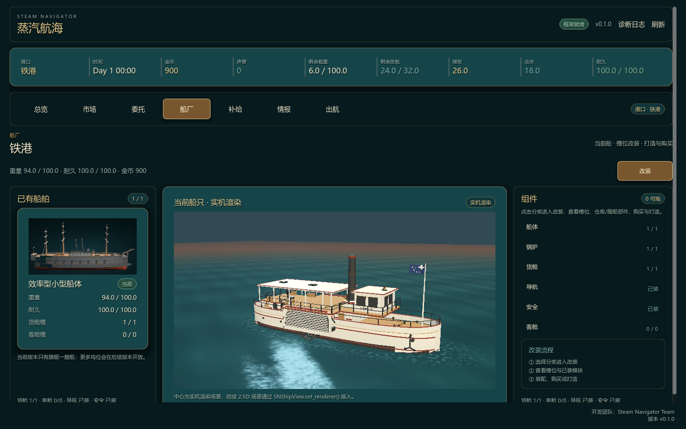

# 2.5D 固定舞台升级方案

> 状态：**阶段 1 首个切片已落地（船厂 3D 实机舞台）**，其余舞台仍按本方案排期。  
> 已实现：`SNShipStage3D` 通过 `SNShipView.set_renderer()` 接入船厂正常态；2D HUD、槽位、拖拽与改装态纵剖图全部保持原样；3D 资产缺失时自动回退程序化占位。  
> 启动条件（其余舞台）：玩法闭环稳定、存档/回归测试稳定、3D 模型与港口资产达到最低可用量。  
> 参考方向：《赏金列车 / Bounty Train》的固定机位场景与场景切换，而不是自由 3D 世界。

## 1. 结论

《蒸汽航海》的 2.5D 不升级成 3D 玩法，而是升级为：

> **2D 经营 UI + 固定机位的 3D 港口/船只舞台 + 舞台间切换。**

玩家始终在一个“当前港口舞台”里；市场、船厂、补给、出航是不同构图和机位的舞台，不是一张可自由行走的大地图。

主港口可以保留**有限环绕**作为看船功能；其他场景保持固定机位，避免相机、构图、点击热区和 UI 互相打架。

## 2. 目标与非目标

### 目标

- 让船和港口成为可感知的空间，而不是纯背景图。
- 用固定机位保证每个场景的构图、可读性和美术质量。
- 场景切换像舞台换景，不像打开一个完全无关的页面。
- 3D 只做表现层，不接管贸易、航行、存档等规则。
- 复用现有 UI、Theme、QueryBus / CommandBus 和内容模组架构。

### 非目标

- 不做可自由行走的 3D 港口。
- 不做自由飞行相机或全 3D 海图。
- 不把贸易/航行规则迁进 3D 节点。
- 不在本轮解决“大世界无缝加载”。
- 不要求每个港口一开始都有完整独立 3D 场景。

## 3. 体验形态

```text
当前港口：PortStage（3D 码头，船停靠）
  ├─ 点击市场 → MarketStage
  ├─ 点击船厂 → ShipyardStage
  ├─ 点击补给 → SupplyStage
  └─ 点击出航 → 离港镜头 → 2D 海图 → 进港镜头 → 目的港 PortStage
```

顶部导航仍然是主导航；场景内的码头标牌/箭头只是同一意图的“场景化入口”，不能成为唯一导航方式。

### 场景清单

| 舞台 | 机位 | 主要内容 | UI |
| --- | --- | --- | --- |
| `PortStage` | 固定 3/4 俯视，可选有限环绕 | 船、码头、起重机、仓库、灯塔、水面 | 顶部 HUD + 总览面板 |
| `MarketStage` | 固定 3/4 | 市场棚、货箱、秤、NPC 剪影 | 市场表格/交易面板 |
| `ShipyardStage` | 固定侧视/3/4 剖切 | 干船坞、船体、模块 socket、起重机 | 船厂/模块面板 |
| `SupplyStage` | 固定 3/4 | 煤堆、水箱、维修台、仓库 | 补给卡、维修报价 |
| `VoyageTransition` | 相机升高/降低 + 2D 海图 | 离港、航线移动、事件、进港 | 时钟、事件卡、跳过按钮 |
| `MainMenuStage` | 可后置 | 港口远景/船停靠 | 主菜单 |

## 4. 相机规则

### 主港口

- 默认固定 3/4 机位，镜头不主动移动。
- 玩家在**空白舞台区域**拖动时，允许固定俯角的有限 yaw 环绕，建议 `±40°～±60°`。
- 不允许改变俯角，不允许穿入船体或地面。
- UI 面板打开时锁定相机；鼠标在 UI 上时不触发环绕。
- 双击/按钮回到默认机位。
- 环绕只作为“看船”功能，不是其他场景的通用相机。

### 其他舞台

- 全部固定机位，不允许绕场景旋转。
- 只允许轻微的入场推镜、idle 呼吸、粒子/水面/烟雾动画。
- 镜头、灯光、前景遮挡都在舞台 `.tscn` 内预置。

### 投影建议

- 优先**正交相机**，更接近 2.5D 立体插画/模型摆件。
- 如果使用透视，宜用长焦低 FOV，避免近大远小破坏 UI 构图。
- 每个舞台固定 `orthogonal_size`，适配 16:9；960 宽下允许裁切边缘，不裁掉可交互热点。

## 5. 架构

```text
GameView (Control)
├── StageHost (SubViewportContainer)
│   └── SubViewport (transparent_bg, own_world_3d)
│       └── active LocationStage (Node3D)
├── HUD (Control)             顶部导航、资源条、时间
├── ScreenUI (Control)        市场/委托/船厂等页面
└── TransitionLayer (Control) 舞台切换遮罩
```

### 5.1 StageHost

- 只负责承载当前 3D 舞台和渲染目标。
- 一个页面同一时间只开一个 3D 舞台。
- 页面隐藏/离开时停止更新，避免后台渲染。
- 建议配置：
  - `SubViewport.transparent_bg = true`
  - `own_world_3d = true`
  - `render_target_update_mode = UPDATE_WHEN_VISIBLE`
  - `SubViewportContainer.stretch = true`
  - 3D 视口分辨率可低于 UI，例如 0.75×，通过 `stretch_shrink` 控制

### 5.2 LocationStage 契约

每个舞台是独立 `.tscn`，根节点统一脚本：

```gdscript
class_name LocationStage
extends Node3D

signal portal_requested(target_id: String)

@export var stage_id: String = ""

func enter(payload: Dictionary) -> void:
    pass

func exit() -> void:
    pass

func bind(view_model: Dictionary) -> void:
    pass
```

- `enter/exit` 只处理舞台内的相机、灯光、动画和局部状态。
- `bind` 只接收 ViewModel；不访问 CommandBus，不写 GameState。
- `portal_requested` 只表达玩家意图，由 StageDirector/Shell 决定跳转。

### 5.3 StageDirector

```text
StageDirector
├── load_stage(stage_id, payload)
├── preload_stage(stage_id)
├── change_stage(stage_id, transition)
└── current_stage()
```

职责：

- 舞台场景加载/卸载/预加载。
- 过渡遮罩和相机切换。
- 目的地舞台的线程预加载。
- 失败回退到 2D 背景。

不建议让每个 UI 页面自己持有 3D 相机或直接 `change_scene_to_file()`。

### 5.4 点击热区

固定机位下优先使用 **2D Control 热点**，而不是 3D 碰撞拾取：

- 码头入口、市场招牌、船厂入口是屏幕坐标上的透明 Button/TextureButton。
- 热点坐标随 StageHost 同尺寸锚定，不在 3D 世界做 RayCast。
- 好处：不受透明物体、粒子、模型层级影响；键盘焦点和本地化提示也更容易做。
- 3D 模型内部不需要碰撞体。

## 6. 出航与进港

### 6.1 时间线

| 时间 | 表现 | 状态 |
| --- | --- | --- |
| 0.0s | 玩家确认出航，命令提交 | 游戏时间和事件已确定 |
| 0.0–0.8s | 港口舞台相机升高，港口淡出 | 表现层计时开始 |
| 0.6–1.2s | 2D 海图淡入 | 3D 舞台隐藏 |
| 1.2–3.5s | 小船沿航路移动，时钟快速推进 | 只读播放 |
| 事件点 | 停在小船位置，弹出事件卡 | 等待玩家选择 |
| 抵达前 | 海图淡出，目的港预加载 | 读取 arrival 数据 |
| 抵达 | 目的港舞台相机从高空降到固定机位 | 舞台 enter |
| 结束 | HUD 恢复，PortStage 可交互 | 状态已落地 |

### 6.2 关键规则

- **命令先提交，演出后播放**：`voyage.start` / `event.choose_option` 已经决定状态，动画只读取结果。
- **表现层时钟**只用于顶部时间显示和进度，不能回写 GameState。
- 事件发生时暂停航路标记；事件选项结算后继续到抵达或下一个事件。
- 必须支持“跳过演出”：直接落到最终状态，不跳命令。
- 演出期间禁用存档/读档，或保证快照一致。
- 目的港舞台在航行阶段线程预加载，避免读条。
- 进港时 3D 场景从高空落下，与海图用云层/暗角/淡出遮罩衔接，不需要 3D 与 2D 几何真正连续。

## 7. 3D 资产约定

沿用 [MODELING_WORKFLOW.md](MODELING_WORKFLOW.md) 的建模流程，并补充：

- 单位米，Blender +X 为船首、+Z 向上；Godot 导入后按现有约定绕 Y 轴修正。
- 船体轴心在中部水线；道具轴心在地面中心。
- GLB 不导出 Blender 相机和灯光；相机/灯光属于 Godot Stage。
- 船体预留 socket：
  - `SN_Socket_Engine`
  - `SN_Socket_Cabin`
  - `SN_Socket_Navigation`
  - `SN_Socket_Safety`
- 港口使用模块化资产：码头段、起重机、仓库、灯塔、市场棚、煤堆、水箱。
- 低模、平直着色、3–5 个材质、优先调色板而不是贴图。
- 至少准备 `LOD0/LOD1` 或 `visibility_range`；远景港口不加载高模。
- 每个舞台的 3D 预算单独记录，避免一个页面多个视口。

### 数据映射

```json
{
  "port_id": "port_0",
  "stage_scene": "res://framework/ui/stages/port_stage.tscn",
  "diorama_id": "harbor.iron",
  "ship_visual_id": "ship.small_efficient"
}
```

- 内容包优先只提供数据与资产键，舞台场景先放在框架/官方 UI 目录。
- 模组自带 `.glb` 需要单独评审内容白名单；不要让任意模组随意加载场景脚本。
- 视觉缺失时回退现有 2D banner/船图，不阻断玩法。

### 内容资产交付：全部走模组（2026-10 起）

游戏本体 PCK 只保留**框架资源**：代码、Theme/字体、UI 外壳图、音频、水面 shader/材质/噪声贴图。

**内容资产全部随 core 模组发布**，本体不打包：

| 资产 | 归属 | 路径 / 键 |
| --- | --- | --- |
| 船体模型 | core 模组 | `dev_mods/core/assets/models/ships/*.glb`，键 `model.ship.*` |
| 模块/道具/货物模型 | core 模组 | `dev_mods/core/assets/models/{modules,props,goods,materials}/`，键 `model.*` |
| 港口横幅/图标 | core 模组 | `core/assets/ports`、`core/assets/icons`，键 `banner.*` / `icon.*` |
| 3D 舞台场景、机位、灯光、水面 | 框架 | `framework/ui/...` 与 `assets/{shaders,materials,textures}/water` |

运行时加载链路：

- `export_presets.cfg` 的 `exclude_filter` 已加入 `assets/models/*`，导出包不再包含内容模型。
- `AssetService.load_texture()/load_model()` 是统一入口：先 `resolve()` 到物理路径；框架资源走 `ResourceLoader`，模组内原始 `.png/.glb` 走 `ContentAssetLoader`（`Image.load_from_file` / `GLTFDocument.append_from_file`）。
- 船体 3D 模型不再按 `hull_tier` 硬编码路径，而是读船体定义的 `information.model` 资产键（`model.ship.*`）；解析不到才回退旧路径/程序化占位。
- 港口横幅同样通过 `banner.port.*` 资产键从模组加载，直接读原始 PNG。

新增内容资产的做法：放进 `dev_mods/core/assets/models/<category>/`，在 `dev_mods/core/manifest.json` 声明 `model.<category>.<name>`，然后 `pwsh tools/pack_core.ps1`；**不要**再放到 `res://assets/models`（那目录已不进发布包）。

### 场景填充与远景（固定机位的构图预算）

固定机位意味着**只填一个取景框**：镜头永远看不到的背后与侧面不建，画面内每个像素都属于下面某一层。缺内容时不是“留黑”，而是用雾、水面、云做刻意的空。

| 层 | 内容 | 实现 | 交互 |
| --- | --- | --- | --- |
| L0 天空 | 渐变天空、太阳/月亮光晕、云带 | `WorldEnvironment` 程序化天空或 Sky shader + billboard 云 | 无 |
| L1 远景剪影 | 山体、城市天际线、灯塔、要塞 | unshaded 低模或烘焙背板 + 雾，不做细节 | 无 |
| L2 中景岸线 | 岸壁、仓库群、轨道、烟囱、塔吊群 | 模块化 kit（`LOD` / `visibility_range`） | 无（热点在 2D） |
| L3 港口设施 | 码头、市场棚、煤堆、水箱、系缆桩、货箱 | 复用现有港口道具资产 | 2D 热点 |
| L4 水面 | 波动水面、泡沫、航迹 | `harbor_water` shader | 无 |
| L5 船只/漂浮物 | 玩家船、停泊船、驳船、小艇、浮标、海鸥、浮木 | GLB 或 billboard | 玩家船可检视 |
| L6 前景框 | 吊机臂、桅杆、雨棚、缆绳、蒸汽 | 单面片/低模，压暗边缘 | 无 |
| L7 大气与遮罩 | 雾、蒸汽、雨、暗角 | 粒子 + 屏幕后期/遮罩 | 无 |

原则：

1. **镜头外不建**；可见边界用雾、海岸线、前景框收住，不出现空黑背景。
2. **远景不交互、不投影阴影**；中景只保留轮廓，细节预算给近景设施与船。
3. **视差用静态构图替代**：远景几乎不动、中景轻微晃动，只有 idle 呼吸、旗帜、蒸汽与水面在动。
4. **远景可先用 2D 背板兜底**：现有 5 张港口 banner 可以直接烘焙成 L1 远景，验证构图后再逐张替换为 3D 剪影，避免一次性建模拖延。
5. **天空/雾/天气由数据决定**：来自 `weather_profiles` 与港口调色，不在运行时随机换天，避免同一港口两次进港气质不同。
6. **空要刻意**：留水面、雾、云和远帆，不要留“未填充的黑色盒子”。

数据映射扩展（`diorama` 块，可选字段，缺省回退默认 kit）：

```json
{
  "kit": "harbor.coastal",
  "backdrop": "backdrop.iron_coast",
  "sky": "sky.temperate_dusk",
  "shore_kit": "shore.coastal",
  "foreground_frame": "frame.crane_arm",
  "animated": ["steam", "gulls", "flags"],
  "density": "sparse|normal|busy"
}
```

- `backdrop` / `shore_kit` / `foreground_frame` 都是官方 kit id，第三方只能换 `facility_visuals` 与 `backdrop` 的道具资产，不能改构图。
- `density` 控制 L2/L5 的实例数量，低配与 960 宽可降档，不影响可交互设施。

第一版预算（单舞台，1440×900）：

- draw call ≤ 120，三角面 ≤ 60k；`L0` 0–1、`L1` 1–3、`L2` 8–20、`L3` 10–30、`L4` 1、`L5` 1–6、`L6` 2–4 个实例，粒子系统 ≤ 3。
- 远景与前景框全部 unshaded/无阴影；只有玩家船与近景设施接收主光。

填充优先级（先让画面“成立”，再让画面“好看”）：

1. L0 天空 + L1 远景背板（先 2D banner 烘焙）→ 消除空黑。
2. L2 中景岸线 + L4 水面收边 → 形成港口空间。
3. L5 停泊船/浮标/海鸥 → 增加生活感。
4. L6 前景框 → 增强纵深与压边。
5. L7 蒸汽/雾/雨 → 最后做氛围。

验收：固定机位截图逐层检查，7 层都有内容或刻意的空；960 宽下不出现空黑；前景框不遮挡 HUD 与 2D 热点。

## 8. UI 约定

- 顶部导航和资源 HUD 始终保持，场景切换不重建整个页面。
- 3D 舞台是背景层；2D 面板放在上方，但要有足够的暗角/半透明底板保证可读性。
- 市场表格、委托卡、船厂面板继续使用现有 Theme 与组件。
- 场景内的入口/箭头是辅助导航，不能替代顶部导航。
- 960 宽下允许隐藏场景边缘装饰，但价格、持仓、操作按钮必须保留。
- 降低动态效果设置应能关闭环绕、粒子、相机推拉，保留静态舞台。

### 设施锚点（哪些必须建模）

设施是玩法功能，视觉上只需要**锚点道具 + 1–2 个辅助件 + 图标招牌**；不做完整建筑、不做室内、不做碰撞。点击命中继续用 2D 热点（见 §5.4）。

第一批建模工单与逐件规格：[PORT_FACILITIES_PLAN.md](../../tools/modeling/briefs/PORT_FACILITIES_PLAN.md) / [sn_port_facilities_batch1.json](../../tools/modeling/briefs/sn_port_facilities_batch1.json)。

| 设施 | 锚点模型（必备） | 辅助件（复用/可选） | 预算 |
| --- | --- | --- | --- |
| `exchange` | 市场棚 / 交易亭 | 货箱、遮阳布、秤、吊牌 | 3–6k tri / 2 材质 |
| `contracts` | 告示板 | 路灯、纸张 billboard、长椅 | 1–2k tri |
| `supply` | 煤堆 + 水箱 | 输煤槽、水管、吊桶 | 2–4k tri |
| `shipyard` | 干船坞 / 滑道 + 龙门吊 | 船体分段、脚手架、工具车 | 5–10k tri |
| `intel` | 信号塔 / 旗语杆 | 望远镜、灯、地图台 | 2–4k tri |

明确不建：

- 室内、柜台内部、NPC 个体（用剪影或 billboard 代理）。
- 招牌上的本地化文字（3D 用图标/纹样；文字交给 2D 标签层，避免每种语言一套贴图）。
- 设施背面与镜头不可见面；不做碰撞体，不做可进入门。
- 远景仓库群只做剪影（见 §7 场景填充 L2）。

空槽位规则：`facilities` 未包含的设施**不得出现锚点模型**，用“通用岸线 / 货堆 / 空场”填充；不允许“模型有船厂但数据没有”。同一港口 `size` 决定槽位数量与锚点尺度，`palette` 决定材质色调，`landmark` 是唯一允许的港口专属定制件（最多 1 个）。

资产与模组边界：

- 五个锚点属于官方 core kit，随版本发布；第三方只能通过 `facility_visuals` 把某个设施替换为白名单内单文件 GLB，不能新增设施类型或改变槽位布局。
- 替换件必须满足尺寸/轴心/三角面/材质数约束，缺失或不合规时回退官方锚点并给 `warning`。
- 每个锚点两级 LOD：近景全模、远景剪影 unshaded；编辑器用现有 GLB 缩略图流程选择。

## 9. 性能与质量

- 同一时间只渲染一个 3D 舞台。
- 隐藏舞台立即停更新，不保留后台 SubViewport。
- 3D 分辨率可低于 UI；优先保证 60fps。
- 一个主方向光 + 一个补光；实时阴影默认关闭，用 blob/接触阴影替代。
- 烟雾、蒸汽用低数量 GPUParticles；水面用简单材质/法线动画。
- 舞台切换用预加载 + 遮罩，不做同步大资源加载。
- 验收至少覆盖 1440×900、1280×720 和 960 宽窗口。
- 导出 Windows/Linux 后实测，不只 headless。

## 10. 风险

| 风险 | 应对 |
| --- | --- |
| 每个场景独立布景导致资产爆炸 | 先做 3 个舞台，共用港口资产库；独立室内后置 |
| 固定机位显得像菜单 | 加场景内热点、短推镜、音效、环境动画，但保持固定构图 |
| 主港口环绕与其他场景冲突 | 环绕只限当前港口，且面板打开时锁定 |
| UI 挡住 3D 热点 | 热点用 2D Control 固定坐标，避免 3D 拾取 |
| 出航演出与状态不同步 | 命令先提交，演出只读；跳过和事件走同一状态机 |
| 进港卡顿 | 航行期间预加载目的港 Stage；失败回退 2D |
| 低配性能不足 | 单舞台、低分辨率 3D、关闭阴影/粒子、质量档位 |
| 模组 3D 资产安全 | 先只允许官方资产；第三方 `.glb` 单独评审白名单 |

## 11. 分阶段计划（暂缓）

### 实现进度（2026-10）

阶段 1 的首个切片已完成，验证了「3D 舞台 + 2D HUD」这条路线在当前架构里可行：

- [framework/ui/components/sn_ship_stage_3d.gd](../../framework/ui/components/sn_ship_stage_3d.gd)：`SubViewportContainer + SubViewport + own_world_3d` 的 3D 船厂舞台，按 `hull_tier` 选 `assets/models/ships/*.glb`，动态取包围盒做固定 3/4 机位取景；复用 `assets/materials/water/harbor_water.tres` 水面着色器，并把船体泡沫环参数绑到当前船体包围盒。
- [framework/ui/screens/port/shipyard_screen.gd](../../framework/ui/screens/port/shipyard_screen.gd)：正常态挂载 3D 舞台；改装态隐藏 3D、继续用纵剖图贴图；2D 槽位卡、拖拽、分类页签与所有命令路径未改。
- 回退策略：`SNShipStage3D.is_supported()` 为 false（没有可用船体 GLB）时不创建视口，保持 `SNShipView` 程序化占位，导出包与 CI 都不依赖新资产。
- 测试：`test_shipyard_refit` 的 renderer 用例同时覆盖「有 3D 资产 → 默认挂载、改装态隐藏」与「无资产 → 保留占位」两条分支。



尚未实现（仍需按本方案推进）：

- 港口/市场/补给舞台与出航进港演出；顶部导航之外的场景内热点；有限环绕相机。
- 3D 舞台的显隐开关（低配/降级设置）；当前只有资产缺失时的自动回退。

### 启动门槛

- MVP 贸易/委托/航行/通关闭环稳定，回归测试稳定。
- 至少 2 艘船体视觉、1 个港口 kit、3 个模块 socket 资产可用。
- 现有 UI 的高频决策页完成第二轮整理。
- 存档、导出、回退路径可验证。

### 阶段

1. **StageHost + PortStage**：一个港口、一艘船、固定 3/4 机位；2D HUD 不变；验证透明合成和性能。
2. **MarketStage + ShipyardStage**：固定机位、场景热点、顶部导航切换、无读条过渡。
3. **出航/进港演出**：离港拉高→海图→事件→进港降落；跳过和事件暂停。
4. **SupplyStage / 目的港变体**：港口 kit 模块化，目的地复用同一舞台骨架。
5. **主菜单/观景模式/质量档位**：有限环绕、画质设置、低配回退。
6. **第三方 3D 资产**：按白名单和安全评审决定是否开放。

## 12. 验收标准

- 2.5D 舞台只作为表现层，不引入新的游戏规则。
- 同一时间只有一个 3D 舞台渲染。
- 场景切换无同步读条；目的地预加载可回退。
- 航行演出期间 HUD 时钟与游戏状态最终一致。
- 事件暂停、跳过演出、失败回滚都有明确路径。
- 3D 资产缺失时 2D 回退正常。
- 1440×900 目标 60fps；导出包可运行。
- 顶部导航、工具栏和现有高频决策页不回退。

## 13. 待定问题

- 正交相机 vs 长焦透视：优先正交，待 PortStage 视觉样片决定。
- `MarketStage` / `ShipyardStage` 是否做成同一港口世界的不同机位，还是独立场景：先独立 `.tscn`，共享资产；如果切换感太碎，再合并为镜头站。
- 主港口环绕是否保留：建议作为可选检视模式，不作为默认交互。
- 舞台场景归属：先放 `framework/ui/stages/`；后续再评估是否允许内容包提供舞台描述。
- 是否需要 3D 海图桌面：暂不支持，2D 海图已经形成独立视觉语言。

## 14. 参考

- [赏金列车 / Bounty Train（Steam）](https://store.steampowered.com/app/371520/Bounty_Train/?l=schinese)：固定机位的车厢/车站场景、顶部资源条、场景内切换入口；本方案参考其“舞台感”，但不采用其地图切换读条。
- [物品建模半工作流](MODELING_WORKFLOW.md)
- [美术与音频资产映射](ASSET_MAP.md)
- [UI 原型与落地说明](UI_PROTOTYPE.md)
- [高频决策页面重构指南](HIGH_FREQUENCY_UI_REFACTOR_GUIDE.md)
