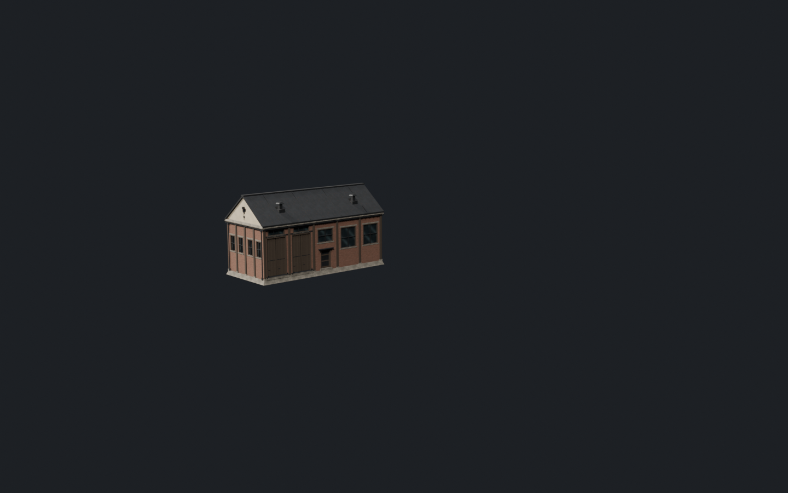
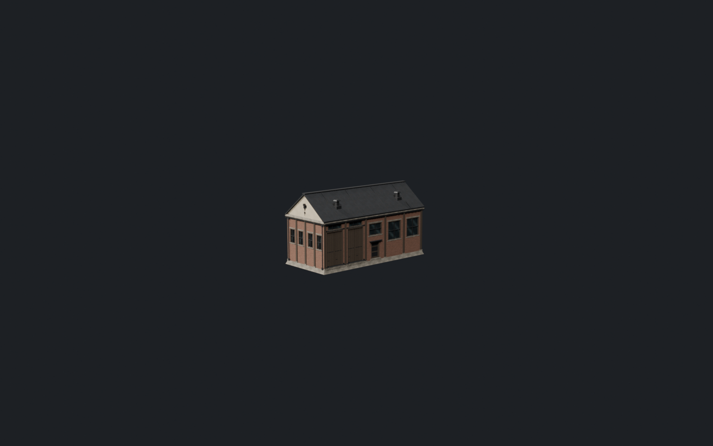
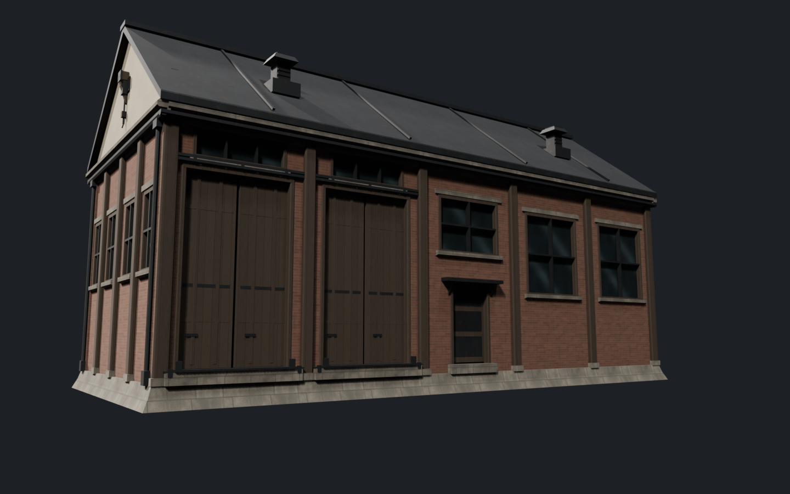
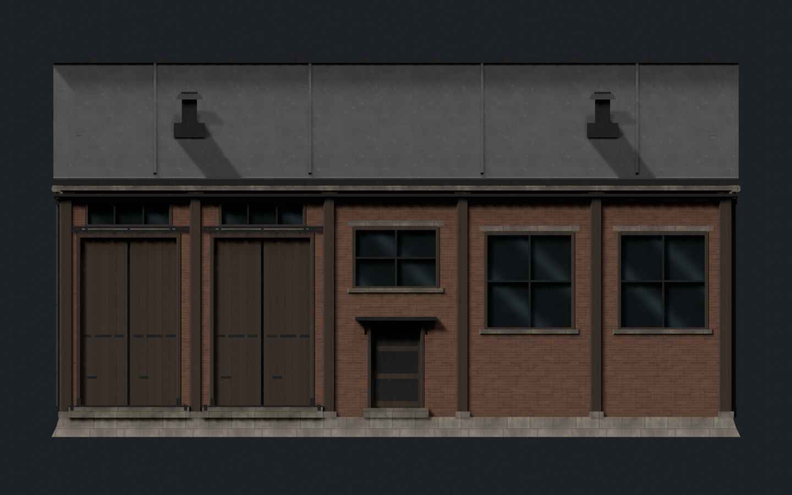
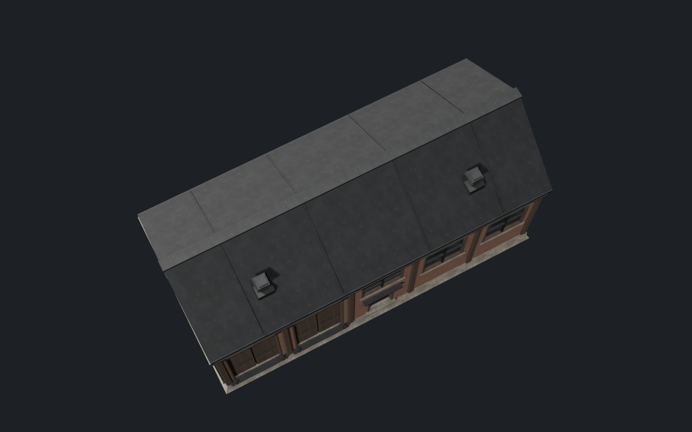
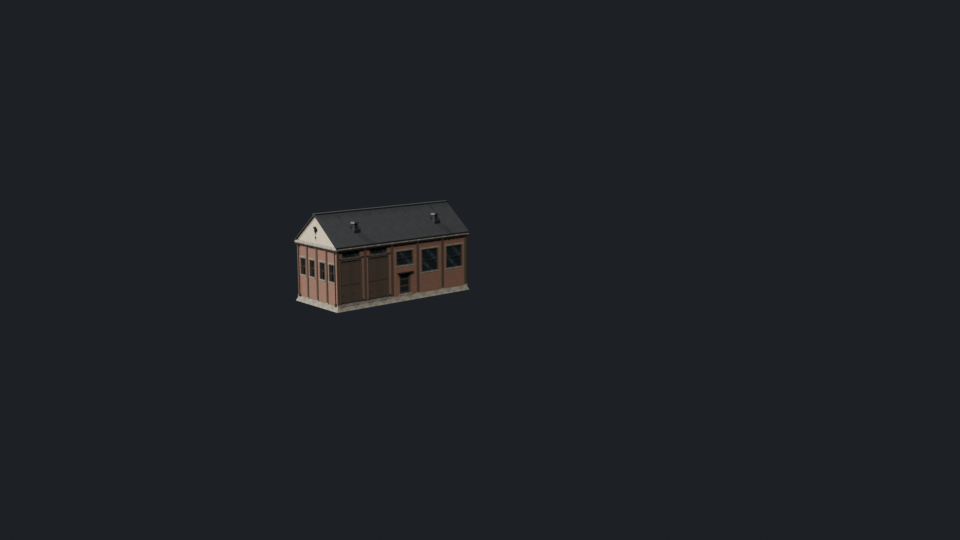
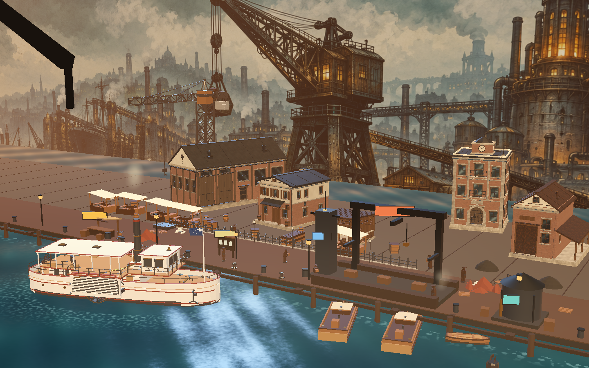
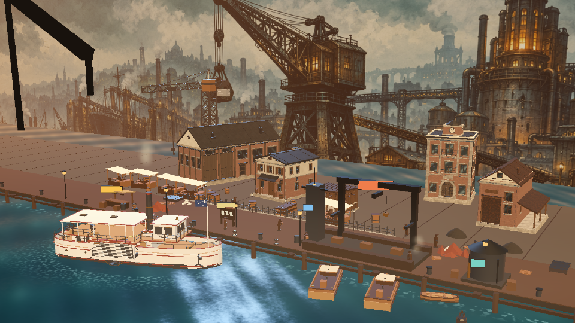

# 铁港建筑套件 · 第一阶段：`SN_HT_Warehouse_Long` LOD0 灰模 + R1

> 工单：[`sn_iron_harbor_architecture_kit_v1.json`](../../tools/modeling/briefs/sn_iron_harbor_architecture_kit_v1.json)
> 状态：**R1 已完成并临时装配进 PortStage、已出 1440×900 / 960×540 实机截图；等待"是否扩展整批"的决定**
> 日期：2026-10-20

## 1. 本阶段边界

| 做 | 不做 |
| --- | --- |
| `SN_HT_Warehouse_Long` 的 LOD0 灰模 + R1 细化，进入集合 `SN_Iron_Harbor_Architecture` | 不制作纹理 / trim sheet / UV |
| 保留原资产名、占地尺寸 20 × 9 × 11 m、轴心（底面中心）、PortStage 槽位布局 `(-48,110,0)` | 不永久替换内容 GLB（R1 仅临时装配截图，已还原旧 GLB） |
| 真实窗门凹口、窗框、石基、壁柱、檐口、屋顶厚度、吊货梁、通风帽、檐沟、落水管、背面服务门 | 不改运行时代码 / manifest / 打包 |
| 固定机位 + 街道低机位 + 正视 + 屋顶 Blender 视图；**PortStage 实机 1440×900 / 960×540** | 不做 LOD1、不建其余 7 栋建筑 |

## 2. 关键决策：主立面朝向按 PortStage 固定机位定

- `framework/ui/stages/port_stage.gd`：town 槽位 `warehouse_long` = `pos(-30, 1.9, -34)`、**yaw −90°**；固定机位 `eye(46,28,64)`、`look_at(0,12,-8)`、`vfov 30°`、`keep_height`。
- 因此机位看到的是资产的 **本地 +X 山墙** 与 **本地 +Y 长墙**；旧 batch1 资产把门窗放 −Y，在机位里完全背对。
- 本样板把装卸门/人门/气窗放 **+Y 主立面**、服务门/后勤窗放 −Y、山墙吊梁留 **+X**；资产名/尺寸/轴心/布局不变。
- **整批 4 栋 drop-in 资产需要统一此约定**，否则固定机位会继续看不到主立面。

## 3. 几何与健康（R1，Blender 实测）

| 指标 | 值 | 工单要求 | 判定 |
| --- | --- | --- | --- |
| 三角面 | **7 436**（4 486 顶点） | `building_medium_lod0` 5 000–8 000 | ✅ |
| 包围盒（局部） | **20.000 × 9.000 × 11.000 m** | 原尺寸 | ✅ |
| 轴心 / 最低点 | 底面中心 / `zmin = 0.000000` | ground centre, z=0 | ✅ |
| 世界包围盒 | `(-58.0, 105.5, 0.0)` → `(-38.0, 114.5, 11.0)` | PortStage 布局不变 | ✅ |
| 材质槽 | **6**：`SN_Town_Stone / Brick / Iron / Glass / Wood / Plaster` | ≤ 6 | ✅ |
| 孤立点 / 退化面 / 非流形边 / 边界边 | **0 / 0 / 0 / 0** | 全 0 | ✅ |
| 同向共面审计（Lead AABB 近似 + 独立 Verifier 三角化裁剪 + BVH 射线） | Verifier 结果：477 对 / 5.74 m²，其中 **0 对位于最外层 AABB 平面、0 对位于墙外表面**；最大外露对为檐沟转角 Iron/Iron 0.0112 m²（同材质、不可见）。原门槛挡铁处 2 对跨材质 0.0044 m² 外露重叠已把挡铁内收 0.05 m 修掉 | 无外露重叠 | ✅ |
| 场景回归 | 245 = 244 旧对象 + 1 新对象；旧 `SN_HT_Warehouse_Long` 1 132 tri / 8 槽 / 位置与可见性不变 | 不改旧对象 | ✅ |

## 4. R1 变更清单（本轮）

| 需求 | 实现 |
| --- | --- |
| 强化双装卸门的滑轨 / 滚轮 / 门槛 / 短平台 | 双道上滑轨 + 3 道吊架；每扇门 2 个 6 边滚轮 + 吊耳；门槛改为「石基座 + 铁门槛板 + 两侧挡铁」；门前加 3.10 × 0.30 m 铁短平台（台面 0.92 m、3 根支腿、2 个防撞柱），全部收在 20 × 9 包围盒内 |
| 补山墙吊货梁与滑轮 | 铁牛腿 + 倒角主梁 + 斜撑 + **双滑轮组**（主轮 r0.15 + 副轮 r0.09）+ 吊链 + 吊钩块 + 钩尖 + 梁端板与螺栓 + 梁端斜拉杆 |
| 檐沟与落水管 | **4 段檐沟**（前后 y=4.32–4.48、左右 x=9.76–9.92，挂在檐口下沿 0.02 内嵌、转角相交）；4 个雨水斗下移到檐沟下方，落水管、3 道管卡、落水口保留 |
| 延续侧墙结构节奏 | 侧墙从「2 窗 + 1 壁柱」改为 **4 窗 + 3 壁柱**（开间 1.5 m 左右交替），与长立面 5 开间节奏呼应 |
| 缩小托盘感基座 | 石基从 0.72 m 压到 **0.58 m**、三级收窄到 19.56 × 8.56；墙脚台阶实测前/后 0.10 m、侧 0.08 m（0.03 是转角壁柱柱础外挑，不是台阶），底面轮廓仍定死 20 × 9 |
| 檐口黑边 / 重叠面排查 | 檐口型材顶面从 7.34 抬到 **7.53**，与屋面底皮（墙口处 7.55）之间只剩 **0.02 m** 阴影缝（原为 0.21 m 黑洞）；檐口/腰线端头内收 0.01 不再与墙面共面；整例同向共面只剩隐藏接缝（见 §3） |

## 5. Blender 六视图

固定 PortStage 机位等价预览（忠实画面 / 居中复查）：




街道低机位（+Y 主立面）与正交正视：




屋顶视图与 960×540 可读性复查：




## 6. PortStage 实机门禁（R1 必须项）

**方法**：R1 GLB 临时写入 `dev_mods/core/assets/models/props/SN_HT_Warehouse_Long.glb`（旧 GLB 备份到 `.design/buildings/iron_harbor/SN_HT_Warehouse_Long_legacy.glb`，候选副本 `…_R1.glb`，SHA-256 `1aa7fd2d…`）→ `godot --headless --path . --import` 刷新导入缓存（PortStage 走 `ResourceLoader.load` 的已导入场景，直接换文件不会生效）→ `tools/godot/capture_port_stage_res.gd` 以 `1440 900` / `960 540` 两次运行抓图 → 还原旧 GLB 并重新 import（内容路径最终为旧资产 67 260 B / SHA-256 `2576e3db…`，Godot 导入缓存同样回到旧资产）。

**证据**：装配前后 stage 三角面 `37 280 → 43 584`（差 **+6 304** = 7 436 − 1 132），两次抓图均报 `town props=47, blockouts=0` → 新模型确实进入了场景并参与批次合并。`draw_meshes` 在不同运行间抖动（88/94/71），不作为材质数证据，只引用三角面差。

**截图口径**：两张图由 `dev_scenes/port_stage/port_stage_preview.tscn` 在 Godot 窗口内真实渲染得到（与游戏同一 PortStage 场景与固定机位、同一套 town 装配逻辑），不是主界面外壳 UI 的整屏截图。

游戏固定机位 1440×900：



游戏固定机位 960×540：



**在游戏机位下的读数（供"是否扩展整批"判断）**
- 1440×900（约 260×190 px、13–17 px/m）：gable 端（+X）4 窗 + 3 壁柱 + 山墙吊梁（梁/滑轮/吊钩）可读；长墙（+Y）2 个双高门 + 气窗 + 人门雨棚 + 2 大窗可读但被 53° 斜视压缩；屋面 2 个通风帽 + 立缝可读；石基不再像托盘。
- 960×540（约 173×127 px、9–11 px/m）：体量、山墙、通风帽、门洞节奏、石基可读；**檐沟（1.6 px）、吊梁/滚轮/滑轨（亚像素）读不出来**——这是分辨率限制，不作为实机可读性证据。
- 遮挡：右侧邻栋（并行工作流调整过的 town 布局）在固定机位挡住本栋长墙右端约 **30–35%**，属布局问题、非模型问题。
- 图像质量：town/船/背景建筑边缘都出现 1 px 蓝白亮点 —— 该现象在**其它建筑上同样存在**，是 PortStage 视口的分辨率/抗锯齿问题（非本模型的重叠面）。接入整批前建议顺带检查 stage 的 MSAA / 3D 视口缩放档位。
- 颜色：灰模在暖色港口灯光下偏暖白，与邻栋砖红差异明显属预期（纹理阶段解决）。

## 7. 工单 acceptance 覆盖（本阶段）

| 验收项 | 状态 |
| --- | --- |
| 前景建筑不得读成没有开口/结构层次的大方块 | ✅ 实机 1440/960 均可读（见 §6） |
| 主要可见立面窗门 100% 有规定深度 | ✅ 窗 0.16 / 装卸门 0.28（门扇 0.16）/ 人门与服务门 0.26（门扇 0.20） |
| > 6 m 可见墙面 surface_breakup | ✅ 长墙 5 开间 + 壁柱；侧墙 4 窗 + 3 壁柱 |
| 材质槽 ≤ 6 / 共享材质 | ✅ 6 |
| 网格健康 | ✅ 0/0/0/0；共面只剩隐藏接缝 |
| 原有对象与集合未被改动 | ✅ 245 = 244 + 1，旧资产逐项不变 |
| 纹理 / UV / LOD1 / 8 栋全量 / 永久替换 GLB / PortStage 正式接线 | ⏸ 未做（按约定） |

## 8. 复现方式

```powershell
# 1) 离线几何自检
python tools/modeling/generators/dryrun_props.py tools/modeling/generators/sn_iron_harbor_architecture_kit_generator.py
```

```python
# 2) Blender 内：重建 + 自检 + 六视图
p = r"<repo>/tools/modeling/generators/sn_iron_harbor_architecture_kit_generator.py"
ns = {"__name__": "kit_gen", "__file__": p}
exec(compile(open(p, encoding="utf-8").read(), p, "exec"), ns)
ns["build_all"](); ns["report"]()
import runpy
runpy.run_path(r"<repo>/tools/modeling/generators/render_iron_harbor_architecture_preview.py", run_name="__main__")
```

```python
# 3) Blender 内：临时装配（备份旧 GLB → 导出 R1 到内容路径）
p = r"<repo>/tools/modeling/generators/export_iron_harbor_architecture_glb.py"
ns = {"__name__": "kit_export", "__file__": p}
exec(compile(open(p, encoding="utf-8").read(), p, "exec"), ns)
ns["export_warehouse_long_r1"]()
```

```powershell
# 4) 刷新导入缓存 + 抓两张实机图
$godot = "<Godot 4.7.2 console exe>"
& $godot --headless --path . --import
& $godot --path . --script res://tools/godot/capture_port_stage_res.gd -- 1440 900
& $godot --path . --script res://tools/godot/capture_port_stage_res.gd -- 960 540
```

```python
# 5) 还原旧 GLB（R1 未获批准前仓库保持旧资产）
ns["restore_legacy_glb"]()
```

```powershell
& $godot --headless --path . --import   # 还原后刷新导入缓存
```

## 9. 待决定

1. **是否把这套模块扩展到其余 4 栋 drop-in（warehouse_short / harbor_office / cargo_shed / tavern）**，并按 §2 统一主立面朝向。
2. 石基高度 0.58 m、侧墙 4 窗 + 3 壁柱的节奏是否作为整套 kit 的统一语言。
3. 固定机位下邻栋遮挡（§6）是否需要在 town 槽位布局里调整。
4. 是否把 R1 GLB 正式替换进内容路径（当前已还原旧 GLB，候选在 `.design/buildings/iron_harbor/SN_HT_Warehouse_Long_R1.glb`）。
