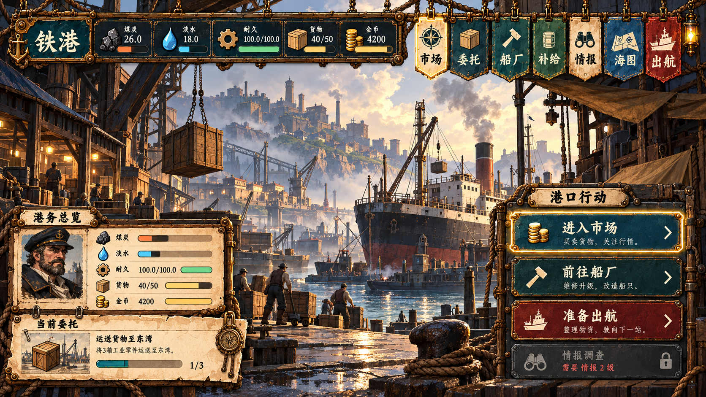
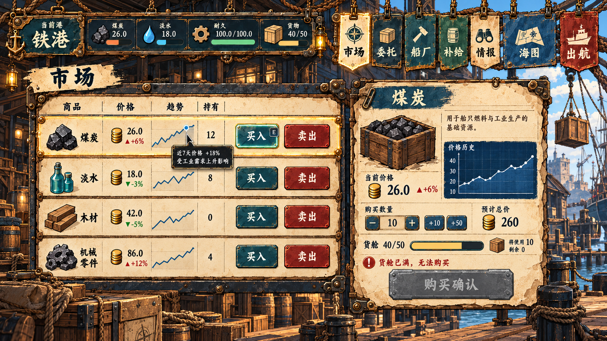
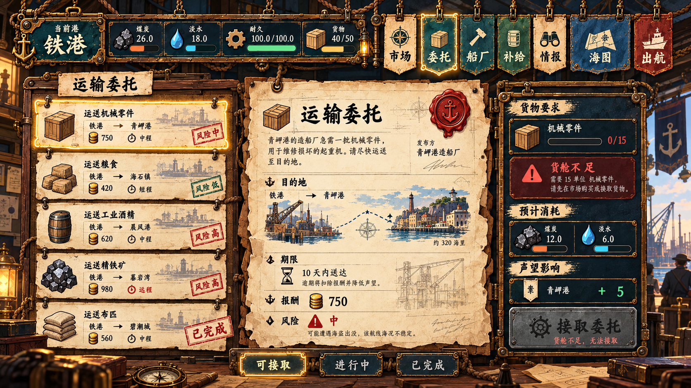
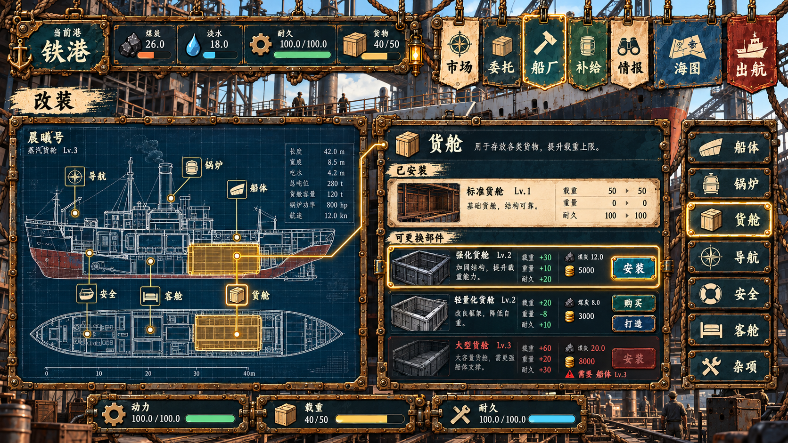
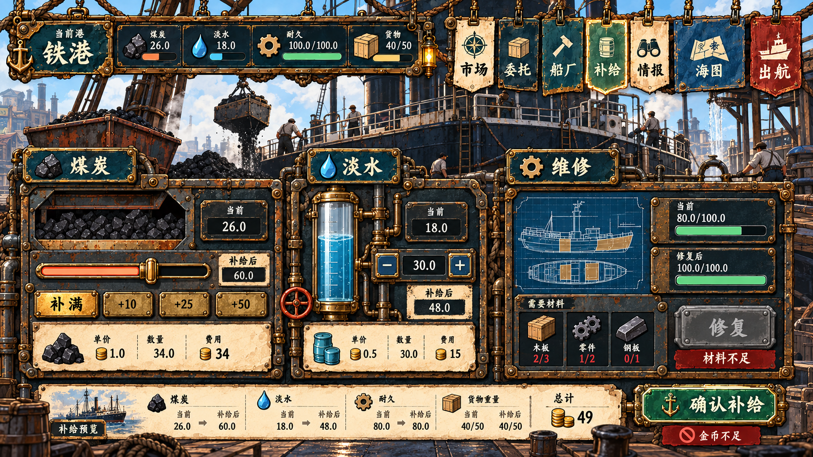
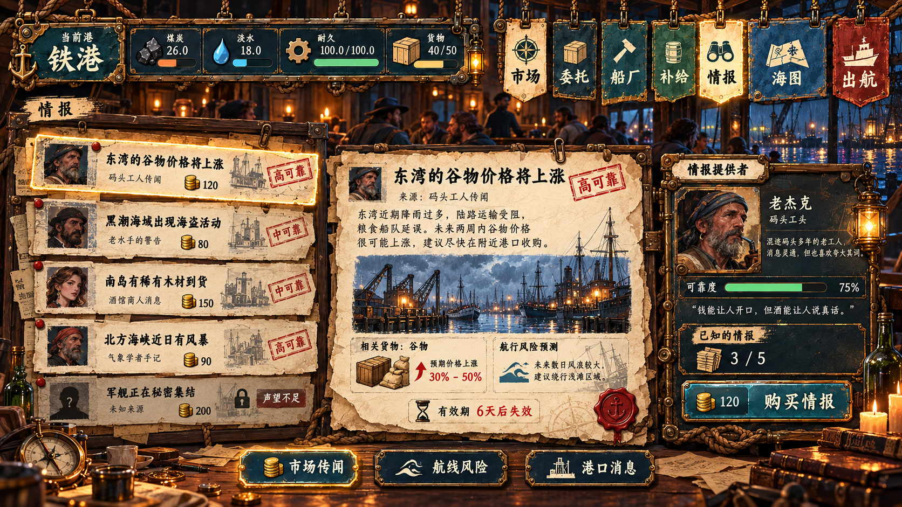
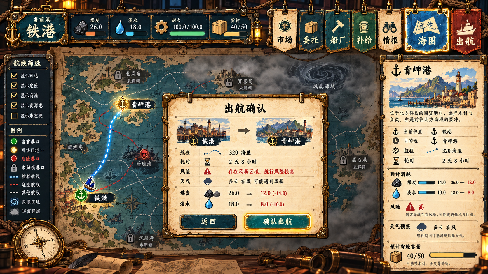
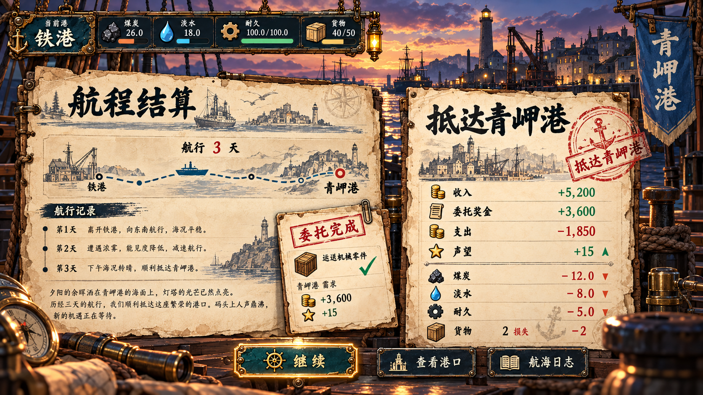

# Steam Navigator UI Screen Prototypes V1

> 状态：视觉原型，用于页面构图、材质分工与信息层级评审；不是生产截图，也不作为像素级实现规范。

本组原型服从 [SN Visual Baseline V1](UI_VISUAL_BASELINE.md) 与 [UI Foundation Spec V1](UI_FOUNDATION_SPEC_V1.md)。图中文字用于表达信息密度和层级，生产时必须改为 Godot 运行时文本、真实数据和可访问交互状态，不得直接把整张原型图切成界面。

## 共同骨架

- 1600×900 逻辑画布，16:9 横向构图。
- 顶部黄铜钢板资源带统一显示港口、煤炭、淡水、耐久、货物和金币。
- 市场、委托、船厂、补给、情报、海图、出航使用同一组悬挂布旗；当前页通过结构连接与黄铜焦点表达。
- 内容只使用黄铜钢板、羊皮纸、蓝图、布旗四个材质族。
- 场景是页面的一部分；面板围绕港口、船坞、酒馆或海图桌组织，不把画面铺成通用后台。
- 状态同时使用文字、图标、色彩和结构变化；原型包含 Focus、Disabled、Warning 等示例。

## 01 总览 / HUD

港口场景保持最大可视面积；左下承载船长状态和当前委托，右侧承载三项港务主操作。它定义所有常驻港口页面的顶部骨架。

## 02 市场

羊皮纸账册负责商品扫描，右侧收据负责数量、总价、货舱容量和确认。趋势图只使用蓝图语义，不为表格另造边框。

## 03 委托

左侧公告板用于选择，中部合同原件用于阅读，右侧钢板区用于条件校验和接取。完成、风险与不可接取状态由印章、文字和颜色共同表达。

## 04 船厂 / 改装

三列结构分别承担船体纵剖蓝图、部件操作和类别页签；槽位与详情通过黄铜连线建立空间对应，避免改装信息退化成普通商品列表。

## 05 补给 / 维修

煤炭、淡水、维修分别使用料仓、液位管和船体检测台；底部统一汇总补给前后数值和成本。普通数值仍以排版为主，不全部仪表化。

## 06 酒馆 / 情报

剪报列表、情报原件与提供者面板组成信息链；可靠度、有效期、来源与购买条件必须在同一视线范围内。

## 07 海图 / 出航确认

海图使用形状、明度和标记区分当前港、可达港、危险港与未知港。出航确认覆盖在航线上方但保留路线和资源预测，使玩家能在确认前复核代价。

## 08 抵达 / 航程结算

结算阶段弱化常驻导航，以航海日志和港务回执并列呈现叙事与数值结果；正负变化同时使用符号、颜色和文字。

## 生成提示词集合

共同提示词：以 SN Visual Baseline V1 为唯一风格参考，生成 16:9 高保真游戏 UI；UI 必须像悬挂、夹持或铆接在蒸汽港口场景中的手绘道具；只使用黄铜钢板、羊皮纸、蓝图、布旗；保持安全文字区、清晰主操作、44 px 以上目标；禁止现代 SaaS 卡片、玻璃拟态、科幻 HUD、无语义边框和第五材质族。

页面差异提示词：

| 页面 | 主内容容器 | 必须验证的交互 |
| --- | --- | --- |
| 总览 | 港口场景 + 钢板操作区 | Focus、Disabled reason |
| 市场 | 羊皮纸账册 + 收据 | Hover row、Buy/Sell、容量不足 |
| 委托 | 公告板 + 合同原件 | Selected、Completed stamp、不可接取 |
| 船厂 | 船体蓝图 + 部件操作区 | Slot linkage、Install、前置条件 |
| 补给 | 料仓/液位/维修控制台 | Slider、前后预览、材料或金币不足 |
| 情报 | 剪报 + 情报原件 | Reliability、Expired/Locked、购买 |
| 海图 | 羊皮纸海图 + 出航弹窗 | Route selection、危险警告、确认 |
| 结算 | 航海日志 + 港务回执 | 正负变化、完成状态、继续 |

## 评审边界

- 原型确认页面的视觉重心、材质比例和组件关系，不确认最终文案、数值或全部边缘状态。
- 图内插画、肖像和场景是构图参考；内容资产仍随 Core 或第三方模组发布。
- 下一步应先挑市场页制作可运行纵向样片，再验证九宫格、安全区、字体、本地化长度、键盘焦点和低动效。
