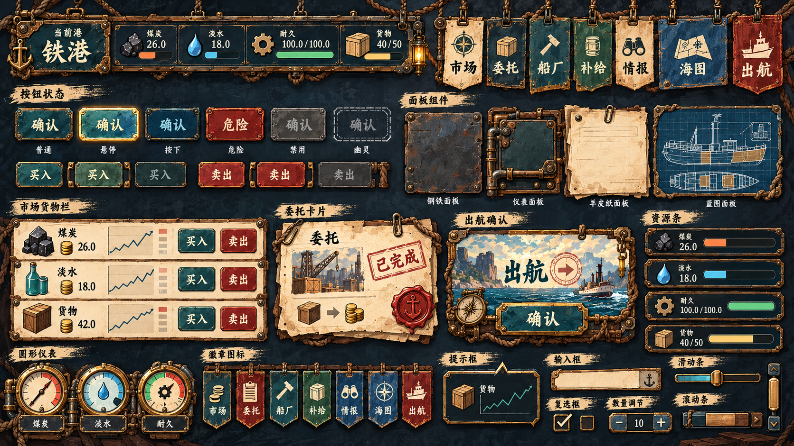
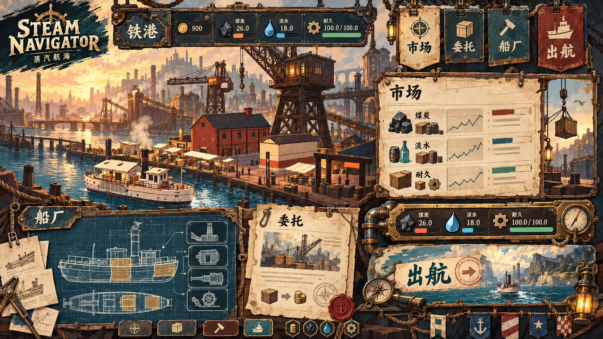

# Steam Navigator Visual Baseline V1

> 状态：V1 生效。方向名称：**风格化港务工坊 × 船长航海账册**（Stylized Harbor Workshop × Captain's Ledger）。

## SN Visual Baseline V1（约束性母版）

这张图定义 SN UI 的风格上限与共同语言：手绘描边、夸张轮廓、材质分族、悬挂结构、图标密度和整体色彩关系。后续 UI 资产与页面样片必须能追溯到该母版。

## UI Kit Concept V1（非约束性概念）

这张图只用于探索 UI 与港口场景结合后的构图、叙事感与氛围，不是生产规范。不得直接从图中裁切资产，不要求逐项复刻其中的边框、布局或装饰；当它与 Visual Baseline V1、交互规范或可读性冲突时，以后两者为准。

生产参数见 [UI Foundation Spec V1](UI_FOUNDATION_SPEC_V1.md)。

## 1. 目标

UI 必须像港口与船只世界中的一组被画出来的道具，而不是覆盖在 3D 场景上的通用管理后台。它继承当前美术的暖灰天空、低多边形硬轮廓、铁锈、煤烟、黄铜与手工作坊质感，同时进一步加入手绘笔触、粗重墨线、夸张挂件和不完全规则的外轮廓。

三个判断问题：

1. 截去文字后，控件是否仍属于蒸汽港口，而不是现代 SaaS？
2. 黄铜钢板、羊皮纸、蓝图和布旗是否具有清晰且一致的材质身份？
3. 玩家能否在三秒内找到当前状态、风险与主要操作？

## 2. 视觉支柱

### 港务工业

- 深色喷漆钢板构成外框，轮廓使用不规则切角、铆接耳和管线转角，而非标准矩形换皮。
- 黄铜只用于结构边、焦点和主要操作，不铺满整块表面。
- 铆钉、绳结、挂钩、管线、铁箍和机械接缝提供尺度感；大轮廓先于小装饰。

### 航海文书

- 合同、任务、结算和市场清单使用暖纸面与深墨色。
- 纸张是信息载体，不是全屏背景；必须嵌在钢制框架内。
- 盖章、编号、航线批注和票据撕边可以承担状态表达。

### 工程制图

- 船厂、部件、性能比较使用暗青蓝图面、细网格和淡青标线。
- 蓝图只承担技术信息，不能替代所有普通面板。

### 仪表反馈

- 煤、水、耐久、载重等核心资源使用刻度、液位和机械读数。
- 普通列表数值保持排版化呈现，避免“每个数值都是表盘”。
- 动效采用卡扣、滑轨、表针、盖章；禁止弹性果冻感和长距离漂浮。

## 3. 颜色与材质

| 角色 | 色值 | 用途 |
| --- | --- | --- |
| 深舱黑 | `#030D0F` | 仪表凹槽、最深背景 |
| 煤烟青 | `#0B2529` | 钢制主框架 |
| 珐琅青 | `#236067` | 次级描边、可交互冷色 |
| 旧黄铜 | `#C59A54` | 结构强调、焦点、主要操作 |
| 抛光黄铜 | `#E1C487` | 高亮文字、悬停与关键数字 |
| 航海纸 | `#D7C9A7` | 合同、账册、结算回执 |
| 深墨 | `#241D17` | 纸面正文 |
| 氧化锈红 | `#9F4D3E` | 危险、亏损、破损 |
| 海水青 | `#4A9594` | 水、航线和技术反馈 |
| 安全绿 | `#76AA8C` | 成功、稳定、已完成 |

色彩比例建议：煤烟/深舱 60%，场景或纸面 24%，黄铜 10%，状态色 6%。任何状态必须同时提供文字、图标或形状，不能只依赖颜色。

## 4. 字体与层级

- 展示标题：Noto Serif SC / 思源宋体，40 px，700。
- 页面标题：Noto Serif SC / 思源宋体，24 px，700。
- 正文：Noto Sans SC / 思源黑体，14–16 px，400。
- 数字：无衬线体等宽数字，关键读数 20–28 px。
- 眉题/编号：11 px，600，字距 0.18 em，使用港务编号与英文短标。

标题负责世界观，正文负责效率。禁止用装饰字体承载长文本，也不把所有标签都做成全大写英文。

## 5. 形状与间距

- 标准组件应有明确的大轮廓模板：横向铆接框、悬挂旗牌、纸张夹板、绳框蓝图、管路仪表槽。
- 实现时允许九宫格内部拉伸，但四角、挂点、绳结、管件和铆接耳不得被拉伸。
- 基础间距 4 / 8 / 12 / 20 / 32 / 48 px。
- 主要按钮高度 48 px；普通按钮 44 px；紧凑步进按钮 36 px；指针目标默认不小于 44×44 px。
- 1600×900 为逻辑设计画布；1440×900 为标准验收窗口；960×540 保留文字、价格、持仓和主要操作。

## 6. 四个主要材质族

| 材质族 | 视觉 | 业务用途 |
| --- | --- | --- |
| Brass Steel / 黄铜钢板 | 深青钢板、黄铜结构边、铆钉、局部管件 | HUD、按钮、仪表、弹窗、输入槽、状态条 |
| Parchment / 羊皮纸 | 暖纸、不规则纸边、纸夹/蜡封、深墨 | 市场账册、合同、任务、结算、Tooltip |
| Blueprint / 蓝图 | 暗青网格、浅色工程线、尺寸标记 | 船厂、部件、性能比较、技术说明 |
| Cloth Flag / 布旗 | 粗布纹、包边、上方挂点、下垂轮廓 | 主导航、港口/阵营识别、强语义入口 |

近黑仪表槽是“黄铜钢板”的内嵌处理，不再是独立材质族。页面不得随意创造第五种主材质，也不得为无特殊用途的卡片增加新边框。边框变化必须服务于交互状态、层级、危险提示或材质结构之一；港口差异通过徽记、印章、插图和局部色带表达。

## 7. 组件契约

- 按钮：Primary 黄铜填充；Secondary 钢板；Danger 锈红；Ghost 只保留标记与文字。
- 页签：像插入卡槽的铭牌；选中态向内容区连接，不能只是变色文字。
- Badge：矩形铭牌或印章，保留明确文字；不使用胶囊形作为全局默认。
- 输入：凹槽表面 + 黄铜焦点框；错误同时显示锈红标记与原因。
- 进度：煤/载重用黄铜，水用海水青，危险耐久用锈红；必须显示数值。
- Tooltip：小型钢框或纸签，标题、解释和快捷键分层。
- 弹窗：钢框包裹纸面/凹槽内容；确认按钮位于机械操作区。

## 8. 页面映射

- 总览/HUD：船桥仪表台与港务铭牌。
- 市场：货运账册、仓单和价格印章。
- 委托：公告板上的合同与港务盖章。
- 船厂：蓝图桌、部件铭牌和工具抽屉。
- 补给：锅炉控制台、压力/液位仪表。
- 酒馆/情报：剪报、便笺、传闻批注。
- 海图：航海桌、墨线、黄铜罗盘和纸签。
- 剧情/结算：航海日志、电报纸和港务回执。

## 9. 动效与交互

完整数值、缓动和状态矩阵以 [UI Foundation Spec V1](UI_FOUNDATION_SPEC_V1.md) 为准。本文件只保留原则：机械响应、短距离运动、状态终点明确；禁止弹性果冻感、持续呼吸缩放和无意义的全屏淡入淡出。

## 10. 资产边界

- 全局框架、Theme、通用图标、九宫格和装饰切片位于 `assets/ui/`。
- 港口徽记、商品插图、设施专属图标属于内容，应随 Core/第三方模组发布。
- 九宫格纹理不得内嵌文字或主题色状态；文字、本地化和状态色仍由 Theme 控制。
- 视觉母版已经确认“手绘资产优先”；Godot Theme 只负责状态映射与文字排版，不再承担主要美术表现。
- 实现资产应从母版重绘/拆分为九宫格、固定角件、绳索/挂钩装饰、纸张、图标和表盘，不直接裁切概念图作为最终资源。

## 11. 验收

- 生产资产必须能归入四个主要材质族；无法归类的边框默认不进入生产。
- 展示页覆盖表面、按钮、页签、徽标、输入、资源仪表、市场行、合同卡、弹窗与状态反馈。
- 1440×900 和 1920×1080 无裁切；960×540 的关键文本和主要操作仍可见。
- 键盘焦点、禁用原因、危险状态和低动效方案均有可见示例。
- 第一批生产资产和市场样片通过评审前不替换生产 Theme；通过后按总览 → 市场 → 海图 → 其他页面的顺序迁移。

## 12. 实现切片清单

1. `frame_hud`：黄铜钢板顶部资源框，固定左右角件，中段可横向延伸。
2. `tab_hanging_*`：统一布旗结构，通过青 / 蓝 / 红 / 中性色带表达语义，图标与文字独立。
3. `button_plate_*`：普通、悬停、按下、危险、禁用、幽灵六状态。
4. `panel_brass_steel` / `panel_parchment` / `panel_blueprint` / `panel_cloth_flag` 四类主表面；仪表槽归入 `panel_brass_steel`。
5. `card_market_row` / `card_contract` / `dialog_voyage` 三类业务样片。
6. `meter_horizontal_*` 与 `gauge_round_*` 两类资源表现。
7. 绳结、挂钩、纸夹、蜡封、管弯头、铆接耳等可选装饰切片。
8. 市场、委托、船厂、补给、情报、海图、出航七枚粗轮廓图标。

首个生产验证页面应为市场：它同时覆盖 HUD、悬挂导航、纸面列表、买卖按钮、趋势图、资源条和 Tooltip，能最早暴露九宫格拉伸与信息密度问题。
