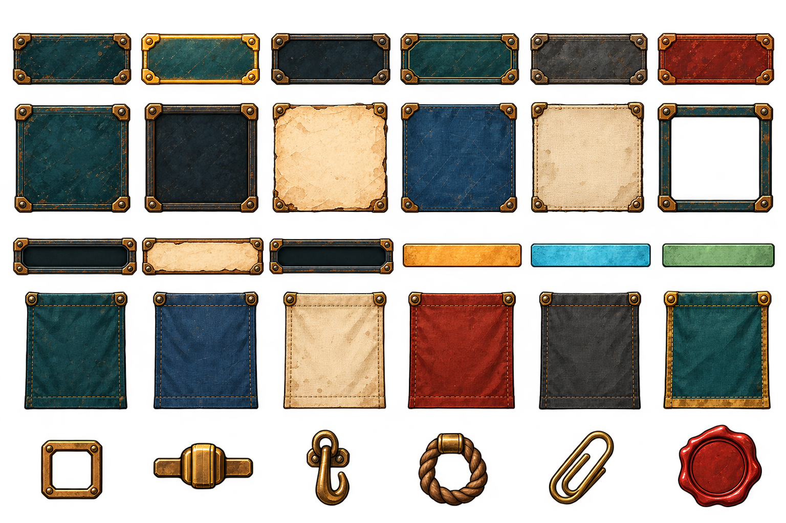

# SN 无字透明 UI 控件 V1

本批使用内置 imagegen，根据 SN Visual Baseline V1 生成。原始 PNG 为 1536×1024，含真实 Alpha 通道；空白处与空心框中心透明。共 30 个独立素材，按 6 列 × 5 行排列，无文字、数字或业务图标。

## 排列

| 行 | 从左到右 |
| --- | --- |
| 1 | 按钮：普通、悬停、按下、选中、禁用、危险 |
| 2 | 钢板、凹槽、羊皮纸、蓝图底面、帆布、空心外框 |
| 3 | 输入槽、纸面列表条、进度槽、琥珀填充、蓝色填充、绿色填充 |
| 4 | 布旗：青、蓝、米白、红、禁用、选中 |
| 5 | 空复选框、滑块柄、挂钩、绳环、纸夹、空白蜡封 |

## 裁切与九宫格

[regions.json](regions.json) 给出 30 个独立区域及建议九宫格边距。坐标采用左上原点，单位为原图像素。区域按 Alpha ≥ 128 的可见主体测量并加 2 px 余量，低透明度的外缘可能超出区域；并非严格的 Alpha 全量包围盒。

- 前四行可按九宫格处理；第五行是固定比例配件，整体等比缩放。
- Godot 可用 AtlasTexture 引用 region，再交给 StyleBoxTexture 或 NinePatchRect；文字、图标和业务状态由节点叠加。
- 九宫格边距以裁切后区域为基准，不以整张图集为基准。角件保持固定，边段仅沿边方向延长，中心可双向延长。
- 推荐初始以 0.5 倍显示；如使用 StyleBoxTexture，将显示边框厚度设为对应源边距的一半。不要为了压缩高度而把上下边框互相挤压。
- 按钮状态原图尺寸存在数像素差异，六态必须放入同一逻辑尺寸的控件中；禁止按每张纹理的自然尺寸切换布局。
- 进度填充与槽分离，按数值裁剪填充，保持同一端对齐。
- 羊皮纸边缘与布面仍含手绘纹理，大倍率拉伸可能使纹理变长；首轮建议在原始尺寸的 1–2 倍内验证，超长条优先用第三行。
- 不要对整个按钮做横向缩放，否则四角铆钉会变形。

本批已验证文件尺寸、透明通道与裁切区域范围。九宫格参数是按可见角件留出的起始建议，尚未在 Godot 内做多尺寸拉伸验收；不能把这一步视为已通过。

完整生成提示词见 [PROMPT.md](PROMPT.md)。本批独立存放，不修改运行时 Theme、共享索引或其他任务文档。

