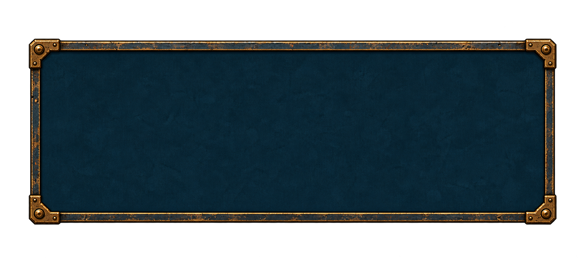
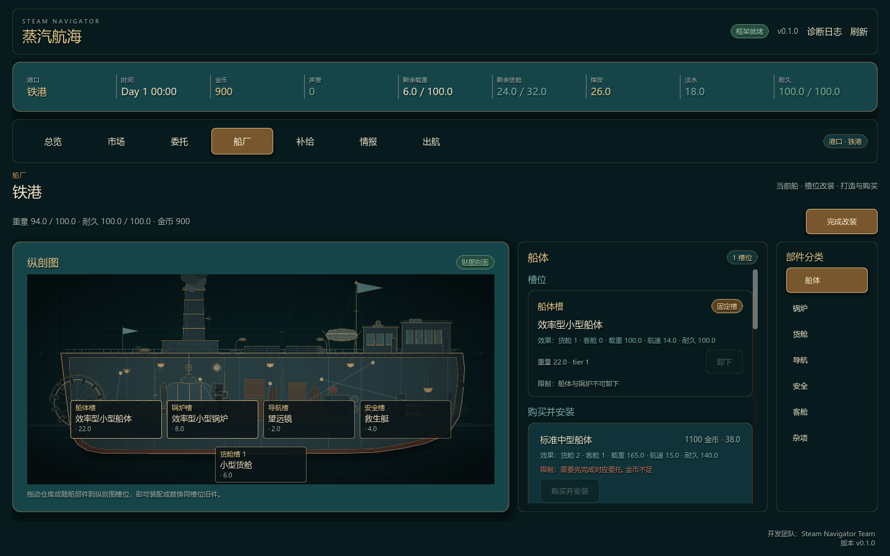

# 改装 UI 蓝图底板 V1

无字、无船图的独立底板，深蓝内容区衬托浅色工程线，钢板边框与黄铜角件沿用改装界面风格。外部是真实透明区域；蓝色内容区保留底色。使用内置 imagegen 生成。

## 导入参数

[layout.json](layout.json) 记录底板区域、九宫格边距以及新旧线图的适配策略。坐标单位为原图像素，原点在左上。

- 底板原图：1860×846。
- 底板取图区域：`Rect2(89, 121, 1682, 598)`，可用 AtlasTexture 去除外部空白，不需要修改 PNG。
- 九宫格固定边距：左/右 112，上/下 108。相对于取图区域。
- 内容安全边距：左/右 132，上/下 124。
- 以 0.5 倍显示时，建议显示边框为左/右 56，上/下 54；内容安全边距为左/右 66，上/下 62。例如底板显示为 840×360，内部空间约为 708×236。Godot 运行时即按这组 0.5 倍数值落地，见文末「Godot 落地」。

## 适配自动裁切后的线图

新版生成器已经负责裁掉透明空白，因此运行时直接使用整张线图纹理，以保持比例、居中的方式放入底板安全区，不再为每艘船保存手工 `Rect2`。

- 线图容器使用 `KEEP_ASPECT_CENTERED`，禁止横向或纵向单独拉伸。
- 如需呼吸空间，在 Control 布局中设置 8–16 px 内边距，不把透明留白重新烘焙进 PNG。
- 槽位坐标保存为裁切后纹理的归一化坐标 `uv = pixel / texture_size`，不同分辨率和底板尺寸共用同一份数据。
- 映射公式：`screen = content_origin + centered_offset + uv * fitted_size`。

叠放顺序：蓝图底板 → 可选独立网格 → 船体线图 → 槽位热区/高亮 → 标注。只有底板做九宫格拉伸；船图始终等比缩放。

## 旧产物兼容

当前工作区里的 `SN_Paddle_Freighter/top.png` 尚未重新生成，仍是 2048×2048 的旧产物；其可见范围约为 `Rect2(91, 802, 1865, 444)`。临时兼容时可使用带 16 px 留白的 `Rect2(75, 786, 1897, 476)`。

兼容逻辑应动态计算 Alpha 包围盒，不能把这个矩形复制给其他船型。新版裁切图的 Alpha 包围盒接近整张图片时，直接使用完整纹理。

网格没有烘焙到纹理中，应以独立图层维持固定间距，避免底板拉伸改变网格比例。无须抠掉 top.png 的黑色：查看器显示的黑色区域实际透明。

## Godot 落地（已验收）

底板在 Godot 里是 **Theme variation + StyleBoxTexture**，不是 `NinePatchRect`：`StyleBoxTexture` 的 `texture_margin_*` 按纹理像素绘制，因此运行时纹理取「取图区域 + 0.5 倍」，九宫格边距随之减半。

| 项 | 值 |
| --- | --- |
| 源图（母版，勿改） | `docs/design/ui_controls_v1/blueprint_panel/blueprint_panel_v1.png`（1860×846） |
| 运行纹理 | `assets/ui/shipyard/blueprint_panel.png`，841×299 = 取图区域 1682×598 裁切后 0.5 倍 |
| 九宫格边距 | 左/右 56，上/下 54（= 源 112/108 × 0.5） |
| 内容安全区 | 左/右 66，上/下 62（= 源 132/124 × 0.5） |
| Theme | variation `SNBlueprintPanel`（`base_type = PanelContainer`），stylebox id `BlueprintPanel` |

运行纹理是母版的派生副本：重新生成母版后必须按 `region` + 0.5 倍重新导出，不要直接缩放整张 1860×846（会带上外部透明留白，九宫格角区会错位）。

使用位置：船厂改装态左列（`_section_panel()` 有每船线稿时改用 `SNBlueprintPanel`，正常态与没有 `blueprint_views` 的旧船仍用 `SNElevatedPanel`）。整列的安全区由 stylebox 的 `content_margin_*` 提供，标题、舞台、底部提示和槽位 chip 都落在蓝色内容区里；`SNShipView.set_blueprint_backdrop(true)` 让舞台不再自绘深色底、每视图边框和槽位坞条，只画线稿、视图标签与武器槽位框。

多尺寸验收（`tools/ui_snapshot.gd`，seed 5201，改装态 hulls / cargo / weapons）：

- 1440×900（设计分辨率）：底板 800×~570，角件与边条无接缝，线稿、chip、提示全在安全区内。
- 960×540：画布 0.667 倍缩放，角件仍清晰。
- 1280×1024（4:3）：列更窄更高，九宫格只拉伸边条与中心。
- 1920×1080 / 2560×1080（超宽）：底板横向拉伸、中线内容不变形；超宽下左列留白变大，属于页面布局而非底板问题。

验收截图：`docs/design/screenshots/shipyard_refit.png`、`shipyard_refit_cargo.png`。

已检查当前旧产物的透明通道与区域尺寸；九宫格参数已在 Godot 内按上表完成多尺寸验收（1440×900 / 960×540 / 1280×1024 / 1920×1080 / 2560×1080）。原始线图与母版 PNG 未修改，运行时只用派生副本。

