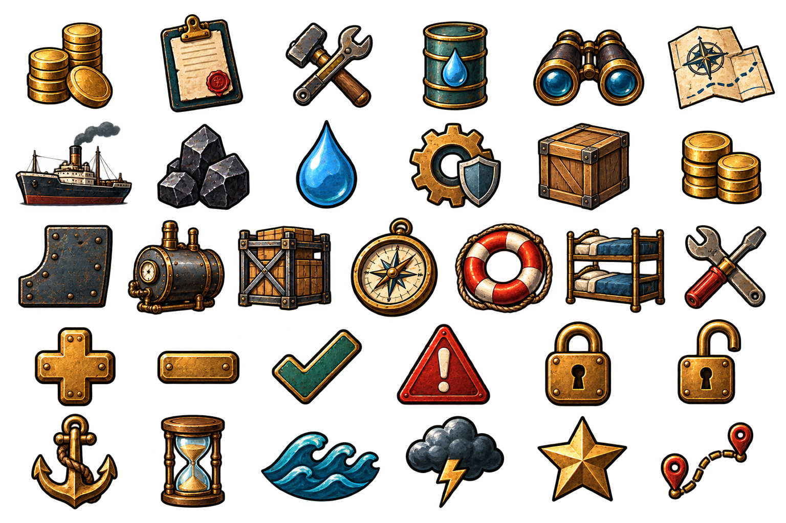

# Steam Navigator 透明 UI Icons V1

本批使用内置 imagegen，参考 SN Visual Baseline V1 与透明控件图集生成。共 30 枚无字图标，保持统一的粗墨线、手绘材质、旧黄铜和港务色彩。背景为真实 Alpha 透明。

## 文件

- `sn_ui_icons_v1.png`：6 列 × 5 行完整图集，1536×1024。
- `icons/*.png`：30 枚独立 PNG；每张使用统一 256×256 透明画布，方便等尺寸替换。
- `manifest.json`：图集区域、独立文件路径与复用别名。
- `PROMPT.md`：完整生成提示词。

## 图标顺序

| 行 | 从左到右 |
| --- | --- |
| 1 | 市场、委托、船厂、补给、情报、海图 |
| 2 | 出航、煤炭、淡水、耐久、货物、金币 |
| 3 | 船体、锅炉、货舱、导航、安全、客舱 |
| 4 | 增加、减少、确认、警告、锁定、解锁 |
| 5 | 锚点、时间、普通海况、风暴、声望、航线 |

船厂“杂项”复用 `nav_shipyard` 的交叉工具图标；货币复用 `resource_coins`。

## 使用建议

- 常规 HUD/按钮显示为 24–32 逻辑像素；主导航可显示为 32–40。
- 独立 PNG 保留统一画布，不会因状态切换改变布局。用 TextureRect 的 `KEEP_ASPECT_CENTERED` 显示。
- 图标本体已经带墨线和材质色，不额外套统一 Tint；禁用态可在 Theme 中降低饱和度与亮度。
- Focus、Selected、Danger 等状态由底板、焦点框或状态覆盖层表达，不复制一套图标颜色。
- 图标不包含文字或底板，可叠加到黄铜钢板、布旗、羊皮纸和蓝图控件。
- 缩到 20 px 以下会丢失手绘细节，最小推荐显示尺寸为 24 px。

已验证完整图集含真实透明通道，并机械拆分为 30 张独立 PNG。图标语义和实际按钮状态仍需在 Godot 页面中验收。

