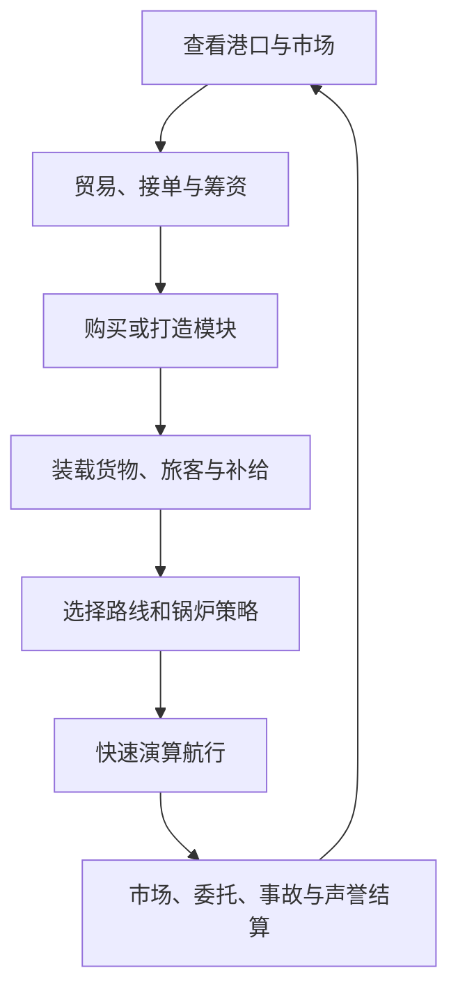

# 《蒸汽航海》MVP 游戏设计文档

> 文档版本：MVP GDD v1.0  
> 目标平台：PC 桌面端  
> 引擎：Godot  
> 交付标准：功能原型，占位美术  
> 单局目标时长：30–45 分钟  
> 核心验证标准：玩家通关后愿意立即再开一局，尝试不同构筑

---

## 1. MVP 定义

### 1.1 核心假设

本 MVP 只验证一件事：

> **锅炉策略与贸易决策结合后，能否形成可理解、可复盘、值得重复尝试的策略取舍。**

游戏不要求玩家在航行中持续操作压力阀。玩家在出航前完成船只构筑、装载、补给、航线和锅炉策略选择；系统随后快速演算航行，并在少量关键事件节点允许有限干预。

### 1.2 核心体验

1. 探索程序生成的港口网络。
2. 观察当前市场，决定买卖、接单和升级方向。
3. 用有限槽位与重量组装船只。
4. 精确计算期限、煤炭和淡水，判断未知风险。
5. 选择经济、标准或极速策略后出航。
6. 承担抵达时间、市场变化、事故和债务的结果。
7. 完成五段主线教学，解锁并组装大型船。

### 1.3 通关条件

- 完成第 5 个主线委托，解锁大型船体。
- 在拥有造船厂的港口组装一艘最低可运行的大型船。
- 最低可运行配置：**大型船体 + 锅炉 + 至少一个货舱**。
- 导航设备、安全设备和客舱不是通关硬条件。

---

## 2. 单局结构

### 2.1 目标节奏

| 项目 | 目标 |
|---|---:|
| 首次通关时间 | 30–45 分钟 |
| 总航行次数 | 9–12 次 |
| 主线委托 | 5 个 |
| 自由跑商或普通委托 | 4–7 次，视玩家路线而定 |
| 港口数量 | 4–5 个 |
| 普通商品 | 每局 4–6 种 |
| NPC 商船 | 每局同时模拟 2–3 艘 |

### 2.2 主线教学链

五个主线委托的教学目标固定，但任务起止港口根据当局地图随机匹配。

| 阶段 | 教学主题 | 强制教学内容 | 完成作用 |
|---|---|---|---|
| 1 | 探索港口 | 查看未知航线、准备最低补给、完成首次航行 | 揭示基础港口网络 |
| 2 | 自由贸易 | 买卖商品、理解重量对速度的影响、观察时变物价 | 建立第一笔升级资金 |
| 3 | 模块制造 | 收集材料、前往造船厂、打造并安装模块 | 解锁中型成长能力 |
| 4 | 客运 | 安装固定客舱、准备额外淡水、承担旅客风险 | 教会时限与声誉管理 |
| 5 | 综合挑战 | 同时运输重货与旅客，在期限内抵达 | 解锁大型船体 |

所有强制教学都嵌入主线步骤，不制作独立教程关。

---

## 3. 核心循环



核心循环中的三种资源压力：

- **时间**：影响准时奖金、情报新鲜度和市场机会。
- **重量**：影响航速，并通过延长航行时间间接增加总煤耗与总耗水。
- **资金**：用于交易、工资、维修、购买、打造与偿债。

---

## 4. 航行结算

### 4.1 交互原则

- 航行采用快速演算，不实时展示长时间移动过程。
- 玩家出航后不能随意改策略，只能在触发事件时从有限方案中选择。
- 普通安全航行大多没有事件；危险航线偶尔出现 1 个事件。
- 每次入港自动存档，可跨会话继续。
- 航行失败时回到最近一次出航前的状态，允许重新配置并重试。

### 4.2 出航预览

出航确认页必须明确显示：

- 航线与目的港。
- 精确预计耗时。
- 精确煤炭消耗。
- 精确淡水消耗。
- 委托期限与是否预计准时。
- 当前总重量与重量上限。
- 已知风险来源，但不显示事故概率。
- 当前情报报告的生成时间。

### 4.3 建议计算框架

```text
有效航速 = 船体基础航速
         × 锅炉速度系数
         × 锅炉策略系数
         × 重量系数
         × 领航修正

预计耗时 = 航线距离 ÷ 有效航速

总煤耗 = 预计耗时 × 锅炉单位时间煤耗 × 策略煤耗系数

总耗水 = 预计耗时
       ×（锅炉单位时间耗水 × 策略耗水系数
       + 旅客人数 × 旅客单位时间耗水）
```

重量系数建议采用容易理解的线性或分段线性函数。总重量越高，航速越低；单位时间煤耗不因重量直接增加。

### 4.4 三种锅炉策略

| 策略 | 速度建议 | 煤耗建议 | 耗水建议 | 风险建议 | 用途 |
|---|---:|---:|---:|---:|---|
| 经济 | 0.75–0.85× | 0.60–0.75× | 0.70–0.85× | 低 | 长途、低利润、补给紧张 |
| 标准 | 1.00× | 1.00× | 1.00× | 中低 | 默认平衡方案 |
| 极速 | 1.20–1.35× | 1.60–2.00× | 1.40–1.80× | 高 | 抢市场、拿准时奖金 |

以上为首轮调参区间，不是最终数值。三个策略必须在不同订单、载重和情报条件下各有合理使用场景。

### 4.5 风险模型

事故概率对玩家隐藏，但风险来源公开。内部风险分数可由以下部分组成：

```text
风险分数 = 航线基础风险
         + 极速策略修正
         + 重载修正
         + 低耐久修正
         - 安全设备修正
         - 工程师修正
         - 领航员修正
```

不得通过毫无提示的独立随机数制造惩罚。风险必须能够追溯到出航前已展示的来源。

---

## 5. 航行事件

### 5.1 事件类别

MVP 只包含：

1. 锅炉过热或机械故障。
2. 偶遇商船并购买市场情报。

动态天气、海况和海盗不进入 MVP。

### 5.2 故障事件

每次事件从可用方案池随机抽取 2 个选项，避免每次都存在固定最优解。

| 方案 | 主要代价 | 主要效果 |
|---|---|---|
| 消耗淡水紧急降温 | 淡水 | 避免或减少延误与耐久损失 |
| 停船检修 | 时间 | 保护耐久，但可能损失准时奖金 |
| 支付额外船员工资抢修 | 金币 | 快速控制故障 |
| 强行继续 | 耐久 | 保持进度，但可能导致航行失败 |
| 抛弃部分普通货物 | 商品与潜在利润 | 减重并降低后续风险或耗时 |

任务货物和旅客不能被主动抛弃。

### 5.3 商船事件

- 玩家可支付金币购买比普通传闻更可靠的情报。
- 情报仍只给出大致航向、货物类别和预计时间区间。
- 该情报可针对某一港口、货类或 NPC 商船更新，不必刷新整份情报站报告。

### 5.4 损失与失败

- 船只只有一个整体耐久值。
- 事故可能造成耐久下降、普通货物损坏、旅客受伤、延误、赔偿和声誉损失。
- 耐久降至 0：当前航行失败，回滚至出航前自动存档。
- 入港后可在补给码头支付金币恢复耐久。

---

## 6. 程序生成海图

### 6.1 地图结构

- 每局生成 4–5 个港口组成的分支网络。
- 港口布局、功能配置和航线连接全部程序生成。
- 航线的主要差异来自：距离与预计时间、沿途补给维修机会、市场情报机会。
- 生成结果必须存在分支选择，不能退化为一条纯线性链。

### 6.2 信息揭示

- 开局只完整显示起始港。
- 未知目的港的位置及其航线连接可见，但设施和商品未知。
- 首次抵达后揭示港口设施与商品市场。
- 性能型导航设备可在出航前揭示未知目的港的设施类型。

### 6.3 生成硬约束

- 初始资金、煤炭和淡水足以抵达至少一个相邻港口。
- 造船厂与情报站都必须能在最多两次航行内找到。
- 所有港口必须可达。
- 第 5 个主线委托的重货、旅客、期限组合必须可由中型阶段的至少一种合法构筑完成。
- 大型船所需的金币、普通材料和专用材料必须在当局地图中实际可取得。

### 6.4 港口设施

| 设施 | 分布 | 功能 |
|---|---|---|
| 交易所 | 所有港口 | 买卖普通商品 |
| 港务承运局 | 所有港口 | 接取主线、货运和客运委托 |
| 补给码头 | 所有港口 | 购买煤水、维修船只 |
| 造船厂 | 专属港口 | 购买、打造、安装船体与模块；销售限量专用材料 |
| 情报站 | 专属港口 | 更新已发现港口的市场与 NPC 商船情报 |

---

## 7. 市场与 NPC 商船

### 7.1 商品

- 每局随机生成 4–6 种普通商品。
- MVP 中普通商品只区分价格与单位重量。
- 不加入保质期、品质、特殊运输许可和易损标签。
- 造船材料与普通商品部分重合，另有少量专用造船材料。

### 7.2 价格变化

物价主要由 2–3 艘后台 NPC 商船的运输行为驱动：

- NPC 向港口输入某类商品：库存上升，价格趋于下降。
- NPC 从港口采购某类商品：库存下降，价格趋于上升。
- 玩家交易也改变当地库存，但不是市场波动的唯一来源。

NPC 不需要显示为可操作的海上实体。模拟只需保存当前位置、目的地、货类、数量区间和预计抵达区间。

### 7.3 情报

- NPC 商船默认隐藏。
- 访问情报站后，获得所有已发现港口的市场预测快照。
- 报告一直保留，直到再次访问情报站；旧报告不会自动更新，必须显示时间戳。
- 报告只显示大致航向、货类和时间区间，不提供精确数量和抵达时刻。
- 未发现港口不进入情报覆盖范围。

---

## 8. 委托与声誉

### 8.1 委托类型

| 类型 | 载荷来源 | 核心约束 |
|---|---|---|
| 定量货运 | 委托方提供指定货物 | 重量、期限、货舱容量 |
| 旅客运输 | 委托方提供旅客 | 独立客舱、淡水、期限、受伤风险 |

不包含采购订单、易损货物专单和多港联运。

### 8.2 报酬

```text
委托总报酬 = 基础报酬 + 准时奖金 - 赔偿
```

- 迟到仍可交付并获得基础报酬，但失去准时奖金。
- 货损或旅客受伤会产生赔偿与声誉损失。
- 准时完成任意运输委托会增加声誉。

### 8.3 持有与刷新

- 同时只能进行 1 个主线委托。
- 可额外承接普通委托。
- 普通委托持有上限随声誉等级提高。
- 每次完成航行后，普通委托池刷新。

### 8.4 声誉用途

- 解锁后续主线委托。
- 解锁高级船体与模块。
- 扩大普通委托持有上限。
- 贷款逾期会扣除声誉。

---

## 9. 船只组装

### 9.1 总体规则

- MVP 只管理一艘船，不做舰队。
- 船体与模块分为小型、中型、大型三级。
- 玩家不断替换当前船体与模块，旧件进入所在港口仓库。
- 旧件可在拥有造船厂的港口免费重新安装。
- 港口仓库彼此独立，模块和材料需要实际运输。
- 未安装模块和材料运输时计入总重量，但不占货舱容量。
- 船体同时限制模块槽位和总重量。

### 9.2 总重量

总重量包含：

- 已安装模块。
- 普通商品。
- 委托货物与旅客载荷。
- 煤炭与淡水。
- 转运中的未安装模块与造船材料。

越重航速越低，但单位时间煤耗不变。

### 9.3 模块类别

| 类别 | 效率型 | 性能型 |
|---|---|---|
| 船体 | 造价更低 | 槽位更多、耐久更高 |
| 锅炉 | 更省煤与水 | 航速更高 |
| 货舱 | 自重更低 | 容量更大 |
| 导航设备 | 降低迷航风险 | 出航前揭示未知目的港设施类型 |
| 安全设备 | 降低维修费用 | 降低事故与货损 |

统一原则：性能型需要更多金币与材料；效率型即使在后期仍可通过节省煤、水或重量保持价值。

### 9.4 客舱

- 客舱是额外模块，不占货舱槽位。
- 使用船体独立客舱槽，并计入总重量。
- MVP 只提供一个固定客舱型号，不做等级和分支。

### 9.5 获取与制造

- 船体和模块可以购买成品，也可以打造。
- 低级打造只需要材料。
- 高级打造同时需要材料与金币。
- 购买和安装即时完成。
- 打造会推进游戏时间，从而改变市场和委托窗口。
- 专用造船材料由特定港口造船厂限量出售。

---

## 10. 初始构筑与岗位

### 10.1 初始二选一

| 构筑 | 设计目标 | 建议配置倾向 |
|---|---|---|
| 低耗稳健型 | 低补给压力、低风险、适合学习 | 效率型锅炉、偏轻货舱、较高初始耐久 |
| 高速冒险型 | 抢期限和市场窗口、承担更高成本 | 性能型锅炉、较少冗余补给、较低容错 |

两套构筑必须都能完成第一主线，且不能存在明显唯一优解。

### 10.2 简化岗位

| 岗位 | 效果 |
|---|---|
| 工程师 | 降低故障风险与维修费用 |
| 领航员 | 缩短航程或识别航线风险 |

- 所有船体都有两个岗位槽，可同时配置工程师和领航员。
- 岗位无等级、属性、装备和个人剧情。
- 每次航行支付工资。
- 玩家可以不雇佣某一岗位，以节省当次航行成本。
- 岗位与对应设备效果直接相加，允许形成强专精构筑。

---

## 11. 经济兜底与贷款

- 玩家资金不足时可申请贷款，避免因煤水、维修或赔偿造成软锁。
- 贷款采用固定利率和固定还款期限。
- 后续收入自动优先还款。
- 到期未还清时扣除声誉，剩余债务继续自动偿还。
- 首轮建议限制为同时 1 笔贷款，额度为一艘中型基础配置成本的 30%–60%。
- 利息建议控制在本金的 5%–15%，还款期建议覆盖 3–5 次航行；实际值以是否仍存在破产压力但不会强制重开为准。

---

## 12. UI 与交互

### 12.1 布局原则

- 海图常驻主画面。
- 港口设施通过侧边面板展开，不切换到独立场景。
- 鼠标优先，关键确认操作可配快捷键。
- 占位美术也必须保证重量、期限、补给、耐久、声誉与债务一眼可见。

### 12.2 必要界面

1. 海图与港口节点。
2. 交易所面板。
3. 港务承运局面板。
4. 造船厂与模块装配面板。
5. 情报报告面板。
6. 补给与维修面板。
7. 出航规划与确认面板。
8. 航行结算与事件选择面板。
9. 通关总结与“使用不同构筑再来一局”入口。

### 12.3 出航确认页优先级

出航确认页是 MVP 最重要的界面，必须把以下因果关系放在同一视野：

```text
模块与载荷
    ↓
总重量
    ↓
预计航速与耗时
    ↓
煤水需求、是否准时、风险来源
    ↓
预期收入与可能损失
```

---

## 13. 状态与数据结构建议

```text
RunState
├── seed
├── game_time
├── money / reputation / debt
├── current_port_id
├── discovered_ports
├── active_main_contract
├── active_normal_contracts
├── ship
│   ├── hull
│   ├── boiler
│   ├── cargo_modules[]
│   ├── navigation_module?
│   ├── safety_module?
│   ├── passenger_cabin?
│   ├── durability
│   ├── cargo[]
│   ├── coal / water
│   └── engineer? / navigator?
├── port_warehouses{}
├── market_state{}
├── npc_traders[]
└── intelligence_snapshot
```

所有规则和数值应数据驱动，便于在 Godot 中通过 Resource、JSON 或 CSV 快速调参。

---

## 14. MVP 验收

### 14.1 功能验收

- 可生成满足硬约束的 4–5 港口地图。
- 玩家可完成探索、贸易、制造、客运和综合挑战五段主线。
- 三种锅炉策略能正确影响耗时、煤水和风险。
- 重量能正确影响速度。
- 市场能被 2–3 艘 NPC 商船推动。
- 情报快照可获取、保留、显示时间戳并被后续市场变化淘汰。
- 船体与五类模块可购买、打造、运输、入库、安装和替换。
- 客舱、工程师、领航员、贷款、维修、声誉和自动存档均可用。
- 第五委托完成后能解锁大型船，满足最低配置后触发通关。

### 14.2 体验验收

核心成功信号：

> 玩家通关后愿意立即再开一局，并主动选择另一套初始构筑或另一条模块路线。

试玩观察重点：

- 玩家是否至少一次因市场情报改变航线或锅炉策略。
- 玩家是否能解释为什么选择经济、标准或极速。
- 玩家是否在货物、补给、材料和模块之间感受到重量取舍。
- 玩家是否认为事故结果来自已知风险，而非纯粹倒霉。
- 是否存在长期压倒性最优的初始构筑、锅炉策略或模块型号。

---

## 15. 明确排除范围

以下系统不进入本 MVP：

- 势力外交、港口投资与占有度。
- 遗迹、先民科技与主线世界谜题。
- 动态天气与海况模拟。
- 海战、海盗与武器系统。
- 舰队、多船编成与拆分调度。
- 船员成长、属性养成与角色剧情。
- 实时压力阀操作与逐秒锅炉热量模拟。
- 产业链生产、港口建设与占领。
- 易损品、保质期、品质、走私和特殊商品许可。
- 多人、排行榜与异步玩家市场。

---

## 16. 首轮调参原则

1. 不追求最终经济平衡，先确保不同构筑产生可见差异。
2. 玩家应在第 3–5 次航行前获得第一次中型升级。
3. 第 5 个主线委托必须要求玩家综合考虑重量、客舱、淡水、期限与风险。
4. 玩家可以通过额外跑商弥补一次明显失误，但不能无成本消除所有后果。
5. 极速策略应能挽救部分期限或抢到市场窗口，但其额外补给和事故成本不能长期优于其他策略。
6. 贷款用于解除软锁，不应成为最优常规融资方式。
7. 通关后结算页应明确展示本局构筑、总航次、准时率、事故次数、总利润、债务和剩余耐久，为再次开局提供比较动机。

---

*文档结束 · MVP GDD v1.0*
